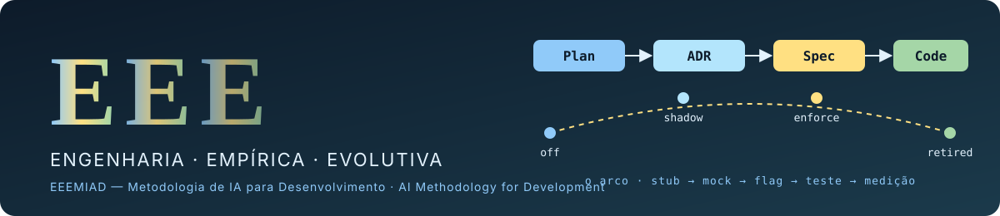
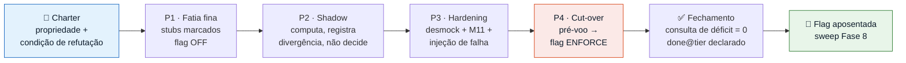

<p align="center">
  
</p>

# ⚖️ EEEMIAD

**Engenharia Empírica Evolutiva — Metodologia de Inteligência Artificial para Desenvolvimento**
*Evolutionary Empirical Engineering — AI Methodology for Software Development*

[](LICENSE)
[](CHANGELOG.md)
[-purple.svg)](docs/)
[](docs/pt/03-hierarquia-da-verdade.md)

> **"O sistema não tem o direito de dizer 'pronto' além da evidência mensurável que possui."**
> *The system has no right to declare "done" beyond the measurable evidence it holds.*

---

## 🌐 Idiomas / Languages

| | Documentação | Entrada recomendada |
|---|---|---|
| 🇧🇷 | [Português](docs/pt/01-visao-geral.md) | [Manifesto](docs/pt/00-manifesto.md) · [Construção Evolutiva](docs/pt/06-construcao-evolutiva.md) · [Guia de Aplicação](docs/pt/08-guia-de-aplicacao.md) |
| 🇺🇸 | [English](docs/en/01-overview.md) | [Manifesto](docs/en/00-manifesto.md) · [Evolutionary Construction](docs/en/06-evolutionary-construction.md) · [Application Guide](docs/en/08-application-guide.md) |
| 🇫🇷 | [Français](docs/fr/README.md) | scaffold e roteiro de tradução |
| 🇪🇸 | [Español](docs/es/README.md) | scaffold e roteiro de tradução |

---

## 🧭 O que é a EEE / What EEE is

A **Engenharia Empírica Evolutiva (EEE)** é uma disciplina de engenharia de software para sistemas em que modelos de linguagem e agentes autônomos constroem código. Três palavras, três compromissos:

| | Compromisso | Mecanismo |
|---|---|---|
| **Engenharia** | Nada é aceito por auto-relato. | Hierarquia `Plan → ADR → Spec → Code`; contratos explícitos; fechamento por reavaliação. |
| **Empírica** | Toda afirmação de estado é medida na fonte. | Par discordável (R2); nível de ground truth (R15); "não exercitado ≠ passou" (R6). |
| **Evolutiva** | O sistema cresce por arcos, nunca por salto. | Fatia fina → stubs e mocks → flag `off → shadow → enforce` → abstração só do que se repetiu. |

**EEEMIAD** é esta publicação: a EEE formulada como metodologia de IA para desenvolvimento, para uso geral e aberto.

> [!NOTE]
> **Escopo.** Este repositório apresenta **somente a EEE**. A instanciação em dois agentes (reflexivo e executivo), com briefs, reality-check de pré-voo e avaliação decisão por decisão, vive no repositório irmão **[EEEMIAD-dual](#-repositórios-irmãos--sibling-repositories)**.

---

## 🚨 O problema / The problem

Agentes de código impressionam na demonstração e colapsam em operação por **ausência de método**, não por falta de inteligência do modelo:

1. **Auto-graduação.** O mesmo agente escreve spec, código e teste; um erro coerente passa na própria verificação. Em medição interna com autoria única, "verificado por execução" ficou em ~0,51 e, mesmo após melhorias, o ~0,62 obtido é um **limite superior** da correção real ([09 §1](docs/pt/09-fundamentacao-academica.md#1-o-problema-epistemológico)).
2. **Resposta plausível.** Valor bem-formado e tipado para uma pergunta que não foi feita; atravessa revisão porque parece resposta.
3. **Inversão de hierarquia.** O código diverge do documento e o documento é ajustado para perdoar o atalho.
4. **"Pronto" pelado.** Tarefas fechadas por auto-relato, sem degrau de evidência declarado.

---

## 🏗️ Como a EEE constrói / How EEE builds



- **O mock valida o cano, não a medida.** Stubs provam que o fluxo atravessa; nunca produzem valor lido como medição.
- **Flags são contratos:** default neutro no código, valor explícito no deploy, domínio `off | shadow | enforce`, postura de falha declarada, linha no ledger.
- **Testes carregam o par discordável:** o alvo passa, o legado passa, **o vizinho segue barrado**. Dívidas entram como `xfail(strict)` e anunciam a própria quitação.

Leia o capítulo completo: [06 · Construção Evolutiva](docs/pt/06-construcao-evolutiva.md). Veja rodando: [`examples/evolutionary-arc/`](examples/evolutionary-arc/README.md).

---

## 🏛️ Pilares / Pillars

| Pilar | Síntese | Capítulo |
|---|---|---|
| 🔺 **Hierarquia da Verdade** | `Plan → ADR → Spec → Code`. O código nunca vence por já estar no ar; o drift sobe para reconciliação. | [03](docs/pt/03-hierarquia-da-verdade.md) |
| 🪜 **Pilha de DONE** | `done@estrutural → funcional → gate → propósito`. Verificação ≠ validação. | [02](docs/pt/02-principios.md) |
| 🔄 **Oito fases** | Exploração → contrato e mock → elo mínimo → hardening → shadow → abstração → cut-over → sweeps. | [04](docs/pt/04-fases-do-ciclo.md) |
| 🔬 **Regras do refinamento** | R1–R10 contra a família da resposta plausível, mais as regras de construção (R11–R30). | [05](docs/pt/05-regras-do-refinamento.md) |
| 🏗️ **Construção evolutiva** | Stubs, mocks, flags e arcos; integração por testes; ampliação evolutiva. | [06](docs/pt/06-construcao-evolutiva.md) |
| 🧯 **Modos de falha (M11)** | Decisão falha fechada; evidência falha aberta com buffer durável. | [05 R7](docs/pt/05-regras-do-refinamento.md), [template](templates/pt/failure-modes-m11-template.md) |
| ⚠️ **Anti-padrões** | Catálogo medido: ratify-and-write, inversão, flag fantasma, mock que vira medida, composição não exercitada. | [07](docs/pt/07-anti-padroes.md) |

---

## 📂 Estrutura / Layout

```
EEEMIAD/
├── docs/
│   ├── pt/   00 manifesto · 01 visão geral · 02 princípios · 03 hierarquia · 04 fases
│   │         05 regras · 06 construção evolutiva · 07 anti-padrões · 08 guia
│   │         09 fundamentação · 10 casos ilustrativos · 11 glossário · 12 primeiros passos
│   ├── en/   (same thirteen chapters)
│   ├── fr/   scaffold + roadmap
│   └── es/   scaffold + roadmap
├── starter/
│   └── eee_init.py                     cria um projeto novo pronto para a EEE, em um comando (12)
├── templates/{pt,en}/
│   ├── adr-template.md                 ADR com alternativas, D1..Dn, ratificação separada
│   ├── arc-charter-template.md         charter de arco: propriedade, refutação, flag, gates
│   ├── flag-ledger-template.md         ledger de enforcement
│   ├── failure-modes-m11-template.md   matriz M11 (gates, sumidouros, entrega com evidência)
│   ├── cutover-evidence-template.md    evidência de cut-over: pré-voo, nível 3b, nível 4
│   ├── task-packet-template.md         pacote de tarefa (divisão opcional por nível de contexto)
│   ├── evidence-journal-template.md    diário de evidências permanente (08 §8.1)
│   ├── agents-entry-template.md        AGENTS.md: entrada neutra quanto ao harness (08 §8.2)
│   ├── request-template.md             pedido de origem + fase de perguntas (08 §1 passo 2)
│   ├── request-matrix-template.md      matriz pedido × arco
│   ├── foundational-plan-template.md   Plan fundacional de uma página
│   ├── operational-state-template.md   estado operacional datado (08 §8.2)
│   ├── operator-decisions-template.md  decisões fixas do operador
│   └── reality-check-template.md       reality-check por símbolo e nível R15
├── skills/
│   ├── eee-adversarial-verifier/       papel "quem verifica": testes a partir da spec, sem ler o código
│   └── eee-governance-sweep/           Fase 8 por AST: fantasmas, paridade, custódia
├── examples/
│   ├── evolutionary-arc/               arco executável off → shadow → enforce (Python puro)
│   ├── reference-implementation/       Plan → ADR → Spec → Code ponta a ponta (FastAPI)
│   └── verification-harness/           verify_hierarchy.py · check_falsification.py · gate.sh · typescript/
└── assets/                             banner e elementos gráficos
```

---

## ⚡ Início rápido / Quick start

```bash
git clone https://github.com/fuzaro/EEEMIAD.git
cd EEEMIAD
python3 -m venv .venv && source .venv/bin/activate
pip install -r examples/verification-harness/requirements.txt
```

**1. Veja um arco completo rodar** (11 testes verdes + 1 dívida declarada em `xfail`):

```bash
pytest -q examples/evolutionary-arc/code/tests
```

**2. Verifique a hierarquia da verdade de um projeto:**

```bash
python3 examples/verification-harness/verify_hierarchy.py --project-root ./examples/reference-implementation
python3 examples/verification-harness/check_falsification.py --test-dir ./examples/reference-implementation/code/tests
```

**3. Comece um projeto novo em um comando** ([passo a passo](docs/pt/12-primeiros-passos.md) · [getting started](docs/en/12-getting-started.md)):

```bash
python3 starter/eee_init.py ~/projetos/meu-sistema --insumos ~/insumos-do-sistema
```

O script cria a árvore de governança, o `AGENTS.md`, o pedido, a matriz pedido × arco, o Plan de uma página, o estado, o diário e o gate único, copia os templates e verificadores com origem e versão, e registra os insumos. Para um projeto legado, siga o [Guia de Aplicação §2](docs/pt/08-guia-de-aplicacao.md).

**4. Integre as skills ao seu assistente de IA:** copie `skills/` para o diretório de skills do seu ambiente, ou cole os prompts em `skills/*/prompts/` no início da sessão.

---

## 📚 Fundamentação / Foundations

A EEE apoia-se em literatura clássica e recente: verdade pragmática e falseabilidade (Peirce, Popper), desenho experimental e controles (Fisher, Neyman–Pearson), verificação × validação (Boehm), processo racional documentado (Parnas–Clements), contratos (Hoare, Dijkstra, Meyer), *fail-safe defaults* (Saltzer–Schroeder), acidentes por composição (Perrow), entrega evolutiva (Gilb, Boehm), dublês de teste e *toggles* (Fowler, Meszaros, Humble–Farley, Hodgson), estabilidade (Nygard), engenharia de software empírica (Basili, Kitchenham), e os limites da autocorreção em LLMs (Huang et al., Kadavath et al.). Bibliografia completa em [09 · Fundamentação Acadêmica](docs/pt/09-fundamentacao-academica.md).

---

## 🔗 Repositórios irmãos / Sibling repositories

| Repositório | Papel |
|---|---|
| **EEEMIAD** (este) | A metodologia EEE: princípios, hierarquia, fases, regras, construção evolutiva, anti-padrões, guia. |
| **EEEMIAD-dual** | A instanciação da EEE em **dois agentes**: papel reflexivo (decide) e executivo (constrói), handoff por brief, reality-check de pré-voo, avaliação de cumprimento decisão por decisão. |

---

## 🤝 Contribuindo / Contributing

Veja [CONTRIBUTING.md](CONTRIBUTING.md). Toda proposta de regra ou anti-padrão entra com **evidência observada**, nunca por analogia.

## 📄 Licença / License

[MIT](LICENSE).

---

*Destilada da prática de campo de um ecossistema real de agentes governados. Publicada para devolver às pessoas suas horas e sua atenção.*
