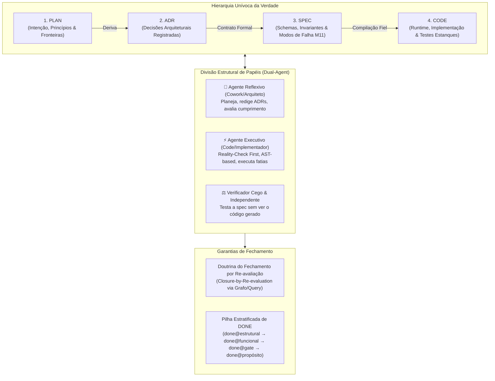

# EEEMIAD ⚖️
### Engenharia Empírica Evolutiva — Metodologia de Inteligência Artificial para Desenvolvimento
### *Evolutionary Empirical Engineering — AI Methodology for Software Development*

[](LICENSE)
[](docs/)
[-purple.svg)](docs/)
[](docs/pt/03-hierarquia-da-verdade.md)

> **"O sistema não tem o direito de dizer 'pronto' além da evidência mensurável que possui."**  
> *The system has no right to declare 'done' beyond the measurable evidence it holds.*

---

## 🌐 Idiomas / Languages
- 🇧🇷 [**Documentação em Português**](docs/pt/01-visao-geral.md) | [Manifesto](docs/pt/00-manifesto.md) | [Guia de Aplicação](docs/pt/08-guia-de-aplicacao.md)
- 🇺🇸 [**English Documentation**](docs/en/01-overview.md) | [Manifesto](docs/en/00-manifesto.md) | [Application Guide](docs/en/08-application-guide.md)
- 🇫🇷 [Guide en Français (Scaffold & Roadmap)](docs/fr/README.md)
- 🇪🇸 [Guía en Español (Scaffold & Roadmap)](docs/es/README.md)

---

## 🚀 O Problema de Mercado / The Market Problem

### Por que 85% dos Agentes de IA Falham ao Chegar na Produção Corporativa
Ferramentas modernas de desenvolvimento assistido por IA (Claude Code, Cursor, Codex, Copilot, AutoGPT) impressionam na demonstração, mas frequentemente colapsam em ambientes corporativos e regulados. O fosso não reside na inteligência do modelo, mas na **ausência de um método de engenharia rigoroso**:

1. **A Falácia da Auto-Graduação ($p_0 \approx 0.616$):** Quando o mesmo agente de IA redige a especificação, gera o código e escreve os testes, surge uma *alucinação conforme*. O modelo comete um defeito lógico sutil e escreve um teste defeituoso que valida com sucesso o seu próprio engano. O teste fica verde (`exit-code 0`), mas a funcionalidade está corrompida.
2. **A Família da Resposta Plausível:** O agente retorna uma resposta perfeitamente bem-formada e tipada para uma pergunta que **não foi feita**. Por parecer correta, atravessa code reviews humanos e testes automatizados rasos.
3. **Spec-Rot e Inversão de Hierarquia (*Hierarchy Inversion*):** O código diverge silenciosamente da documentação. Sob pressão, a documentação é adaptada retroativamente para perdoar o atalho do código, destruindo as invariantes de segurança e governança.
4. **Falsos Dones:** Agentes declaram tarefas como "concluídas" por auto-relato (*self-report*), gerando débito técnico invisível e incidentes severos de produção.

---

## 🛡️ A Solução EEEMIAD / The EEEMIAD Solution

A **EEEMIAD** é uma metodologia de engenharia de software de alta disciplina, forjada em um ecossistema real de mais de 250.000 linhas de código, 52 ADRs arquiteturais, milhares de jobs distribuídos e centenas de milhares de inferências governadas.

Ela transforma o desenvolvimento com agentes de IA de uma "improvisação estocástica contínua" em um **processo de compilação confiável e verificável**.



---

## 🏛️ Os Pilares Fundamentais / Core Pillars

| Pilar | Descrição Sintética | Documento Normativo |
|---|---|---|
| **Hierarquia da Verdade (§2)** | `Plan → ADR → Spec → Code`. O código nunca vence uma divergência contra a especificação por já estar no ar. O desvio sempre sobe para reconciliação na camada superior. | [Hierarquia da Verdade](docs/pt/03-hierarquia-da-verdade.md) |
| **A Pilha de DONE** | Eliminação do "done pelado". Todo avanço deve declarar seu degrau: `done@estrutural`, `done@funcional`, `done@gate` e `done@propósito` (o critério do sino de bambu). | [Princípios Fundamentais](docs/pt/02-principios.md) |
| **As 10 Regras do Refinamento** | Doutrina empírica contra respostas plausíveis (R1 a R10), incluindo pares discordáveis (R2), checagem sintática via AST (R8) e priorização por taxa de degradação (R10). | [10 Regras de Refinamento](docs/pt/05-regras-do-refinamento.md) |
| **Dual-Agent Workflow** | Separação física entre raciocínio reflexivo (Cowork) e execução disciplinada (Code), com reality-check obrigatório antes de qualquer edição. | [Dual-Agent Workflow](docs/pt/06-dual-agent-workflow.md) |
| **Fechamento por Re-avaliação** | Tarefas só são encerradas quando a verificação canônica independente que detectou o déficit é reexecutada e retorna zero — nunca por auto-relato do agente. | [Guia de Aplicação](docs/pt/08-guia-de-aplicacao.md) |
| **Modos de Falha M11** | Mapeamento explícito de postura para cada interface: `Fail-Closed` para decisões de segurança; `Fail-Open com Log Durável` para preservação de evidência histórica. | [Catálogo de Anti-Padrões](docs/pt/07-anti-padroes.md) |

---

## 📂 Estrutura do Repositório / Repository Layout

```
EEEMIAD/
├── docs/                               # Base de Conhecimento Normativa & Teórica
│   ├── pt/                             # Documentação Completa em Português (10 Capítulos)
│   ├── en/                             # Full English Documentation (10 Chapters)
│   ├── fr/                             # Documentation en Français (Scaffolding & Roadmap)
│   └── es/                             # Documentación en Español (Scaffolding & Roadmap)
├── templates/                          # Templates Operacionais Prontos para Uso
│   ├── pt/ & en/
│   │   ├── adr-template.md             # Template Canônico de ADR com Matriz de Decisão
│   │   ├── brief-template.md           # Template de Brief com Pré-Voo de Raio de Explosão
│   │   ├── reality-check-template.md   # Template de Reality-Check "Verificar, Não Confiar"
│   │   ├── evaluation-ledger-template.md # Livro-Razão de Avaliação Decisão por Decisão
│   │   └── failure-modes-m11-template.md # Matriz M11 de Postura em Falha
├── skills/                             # Skills Modulares para Agentes de IA
│   ├── eee-architect/                  # Skill do Agente Reflexivo (Planejamento & ADRs)
│   ├── eee-executor/                   # Skill do Agente Executivo (Reality-Check & AST)
│   ├── eee-adversarial-verifier/       # Skill do Verificador Cego & Independente
│   └── eee-governance-sweep/           # Skill de Varredura Periódica contra Spec-Rot (Fase 8)
└── examples/                           # Harness de Testes e Implementação de Referência
    ├── verification-harness/           # Scripts Python para Validação Automática de Invariantes
    └── reference-implementation/       # Projeto Exemplo Ponta a Ponta (Plan → Code)
```

---

## 🧰 Skills para Agentes (Inspiradas no padrão de mercado)

Nossas skills foram construídas no padrão aberto de agentes modernos ([Antigravity](https://github.com/google), [Claude Code](https://github.com/anthropics), [Cursor](https://cursor.com), [Codex](https://openai.com)):

- [`eee-architect`](skills/eee-architect/SKILL.md): Opera em modo puramente reflexivo. Conduz a elaboração de ADRs com contraditório explícito, análise de alternativas e mapeamento de dependências.
- [`eee-executor`](skills/eee-executor/SKILL.md): Opera em modo estritamente executivo. Executa o **Reality-Check pré-voo**, analisa o código via AST (nunca regex cego) e aplica testes estanques.
- [`eee-adversarial-verifier`](skills/eee-adversarial-verifier/SKILL.md): Rompe a auto-consistência errônea. Gera suítes de testes consumindo apenas a especificação e as ADRs, sem acesso prévio ao código gerado.
- [`eee-governance-sweep`](skills/eee-governance-sweep/SKILL.md): Executa a varredura ritual da Fase 8, detectando rotas órfãs, contratos implícitos, flags fantasma e divergências bidirecionais.

---

## ⚡ Início Rápido / Quick Start

### 1. Clonar o Repositório e Instalar o Harness
```bash
git clone https://github.com/luizsolarsystems/EEEMIAD.git
cd EEEMIAD
python3 -m venv .venv && source .venv/bin/activate
pip install -r examples/verification-harness/requirements.txt
```

### 2. Validar a Integridade de um Projeto com o Harness EEE
```bash
# Executa a verificação estrita da hierarquia Plan -> ADR -> Spec -> Code
python3 examples/verification-harness/verify_hierarchy.py --project-root ./examples/reference-implementation

# Verifica se todos os testes possuem controles negativos e pares discordáveis (Regra R2)
python3 examples/verification-harness/check_falsification.py --test-dir ./examples/reference-implementation/tests
```

### 3. Integrar as Skills ao seu Assistente de IA
Copie a pasta `skills/` para o diretório de customizações do seu ambiente:
- **Antigravity CLI:** `cp -r skills/* ~/.gemini/antigravity-cli/custom/skills/`
- **Claude Code:** Adicione as diretrizes de `skills/` ao seu `CLAUDE.md` corporativo.
- **Cursor / VSCode:** Importe os playbooks em `.cursorrules` ou nas instruções do workspace.

---

## 📜 Fundamentação Acadêmica e Epistemológica
A EEEMIAD apoia-se em literatura seminal da ciência da computação e teoria dos sistemas:
- **Teoria dos Grafos de Propriedade & Ontologias:** Formalização de modelos extensionais para rastreabilidade de artefatos de engenharia (Angles et al., 2017).
- **Semiótica e Pragmatismo de Peirce:** A teoria da verdade como limite da investigação empírica (Peirce, 1878).
- **Verificação Formal e Model Checking:** Princípios de Dijkstra e Hoare aplicados à síntese por modelos probabilísticos.
- **Modelagem Bayesiana de Incerteza:** Calibração com Beta-Bernoulli e limite inferior de Wilson (Wilson, 1927).
- *Leia a fundamentação completa em:* [Fundamentação Acadêmica](docs/pt/09-fundamentacao-academica.md).

---

## 📄 Licença
Distribuído sob a licença [MIT](LICENSE).

---
*Construído com base na experiência real de campo do ecossistema SolarSystemsAI.*  
*Para devolver às pessoas suas horas e sua atenção.*
