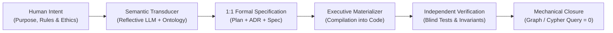
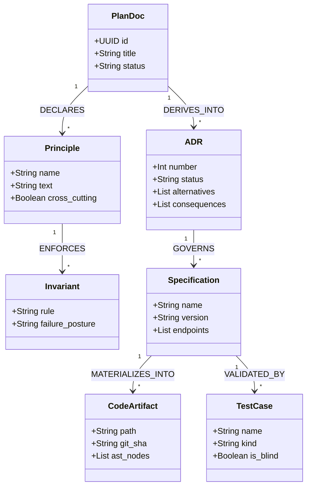

# 01. EEEMIAD Methodology Overview
## Evolutionary Empirical Engineering — AI Methodology for Software Development

---

### 1. Definition and Market Positioning
**EEEMIAD** (**E**volutionary **E**mpirical **E**ngineering — **A**I **M**ethodology for Software **D**evelopment) is a formal software engineering framework engineered to govern the lifecycle of systems where Large Language Models (LLMs) and autonomous agents serve as primary builders.

Unlike ad-hoc practices centered around "prompt engineering" or IDE-bound copilot plugins, EEEMIAD treats agentic software engineering as an **industrial compilation process**.

---

### 2. The Two Paths of Software Development with AI

As formalized in the foundational document *Truth, the Materializer, and DONE*, modern engineering faces a fundamental fork:

| Dimension | Path 2 (The Industry Standard Convention) | Path 1 (The EEEMIAD Doctrine) |
|---|---|---|
| **Core Premise** | The LLM continuously improvises code from vague prompts. | The LLM operates as a compiler faithfully materializing formal specifications into code. |
| **Human Role** | Perpetual debugger of stochastic hallucinations. | High-level validator of intent, governance, and business value. |
| **Ground Truth** | The accumulated legacy codebase in the repository. | The explicit and unambiguous hierarchy: `Plan → ADR → Spec → Code`. |
| **Correctness Guarantee** | Fragile heuristics and tests written by the same model. | Strict role separation, independent blind testing, and topological verification. |
| **Impact on Attention** | Escalating colonization of time through endless reviews. | Genuine return of human hours (the bamboo chime). |

---

### 3. The Methodological Ontology
EEEMIAD is anchored in a strict relational and ontological model (implemented in Property Graphs such as Neo4j):

---

### 4. The Three-Ring Operational Loop
The methodology organizes development across three concentric feedback rings:
1. **The Reflective Ring (Architect / Cowork):** Explores domain implications, drafts formal ADRs, specifies boundaries, and conducts decision-by-decision compliance assessments.
2. **The Executive Ring (Implementer / Code):** Enforces mandatory *pre-flight Reality-Checks*, inspects syntax trees via AST (never blind regex), generates sandboxed code, and reports measured metrics.
3. **The Adversarial Ring (Verifier / Gate):** Executes blind test suites derived exclusively from specifications, re-executes audit queries, and grants closure only via objective evidence.
