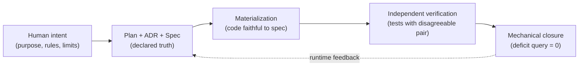
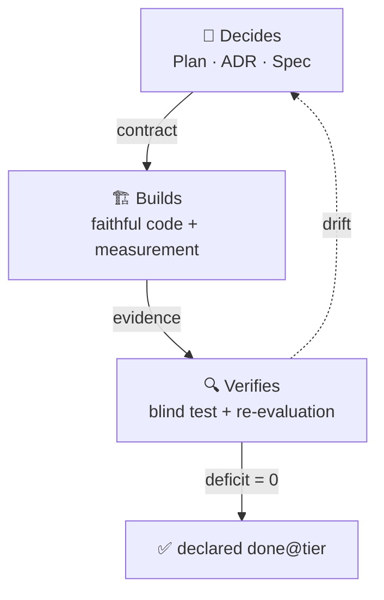

# 🧭 01 · EEE Overview

*Evolutionary Empirical Engineering applied to AI-assisted software development*

---

## 1. Definition

**Evolutionary Empirical Engineering (EEE)** is a software engineering discipline for systems in which language models and autonomous agents act as first-class builders. Three words define it:

| Term | What it imposes |
|---|---|
| **Engineering** | An explicit hierarchy of truth (`Plan → ADR → Spec → Code`), declared contracts and mechanical closure. Nothing is accepted on self-report. |
| **Empirical** | Every state claim is measured at the source, with a disagreeable pair and a declared evidence level. "Not exercised" never counts as "passed". |
| **Evolutionary** | The system grows by **arcs**: thin slice → stubs and mocks → hardening → *shadow* → *enforce* → abstraction only of what repeated. No abstraction is born before its second occurrence. |

**EEEMIAD** is the name of this publication: EEE formulated as an *AI Methodology for Development*. The method is EEE; the suffix names the application domain.

> [!NOTE]
> **Scope of this repository.** Here is EEE itself: principles, hierarchy of truth, phases, rules, evolutionary construction, anti-patterns and the practical guide. Its instantiation with **two agents** (reflective and executive), with briefs, pre-flight reality-check and decision-by-decision evaluation, is handled in the sibling repository [`EEEMIAD-dual`](../../README.md#-repositórios-irmãos--sibling-repositories).

## 2. The problem EEE solves

Code agents impress in demos and collapse in operation for a reason that is not model intelligence: **absence of method**. Four failures recur:

1. **Self-grading.** The same agent writes spec, code and test. A logic error produces a test that validates it. The test is green; the feature is wrong.
2. **Plausible answer.** The system returns a well-formed, typed value for a question that was not asked. Because it looks like an answer, it passes human review and shallow tests.
3. **Hierarchy inversion.** Code drifts from documentation and, under pressure, the documentation is adjusted to forgive the shortcut. Invariants die silently.
4. **Naked "done".** Tasks are closed on self-report, without qualifying the evidence tier reached.

## 3. The two paths

The canonical document *Truth, the Materializer and DONE* formalizes the fork every AI-assisted ecosystem faces:

| Dimension | Path 2 (market convention) | Path 1 (EEE) |
|---|---|---|
| **Premise** | The LLM improvises code from prompts; the human tests the improvisation forever. | The LLM materializes formal specifications into code, as a compiler materializes C into assembly. |
| **Human role** | Perpetual debugger of stochastic output. | Validator of intent, governance and value. |
| **Source of truth** | The code accumulated in the repository. | The hierarchy `Plan → ADR → Spec → Code`. |
| **Guarantee** | Tests generated by the same agent. | Role separation, independent tests, closure by re-evaluation. |
| **Effect on attention** | Growing colonization. | Real return of hours (the bamboo chime). |

## 4. The central tension: fidelity × leverage

The more truth you push into the spec, the more faithful the materialization, and the **less leverage** the approach offers: at the extreme, the program was written twice. The more abstract the spec, the larger the slack in which the model improvises.

> [!IMPORTANT]
> The honest target is not `spec = program`. It is: **the spec specifies enough for the residue of improvisation to be cheap to verify.** That point is chosen per capability, not globally, and each capability's DONE tier **is** its position on that spectrum.

Hence EEE's work programme is *bottom-up*: in each arc, ask which behavioural predicate can next rise from improvisation into the spec. Every predicate raised shrinks improvisation and makes the functional test (the "crutch" of an untrustworthy materializer) less necessary.

## 5. The three roles

EEE separates three roles. They can be held by people, by distinct agents or by combinations; what cannot happen is **one actor holding all three over the same artefact**.

| Role | Responsibility | Typical artefact |
|---|---|---|
| **Who decides** | Makes intent, alternatives and consequences explicit. | Plan, ADR, spec, arc charter |
| **Who builds** | Materializes the spec; measures before editing; reports with command and output. | Code, tests, reality-check |
| **Who verifies** | Tests the spec without seeing the implementation; re-runs the query that detected the deficit. | Independent suite, closure query |

## 6. Reading map

| Chapter | Question it answers |
|---|---|
| [02 · Principles](02-principles.md) | What counts as "done" and what may never be claimed? |
| [03 · Hierarchy of Truth](03-hierarchy-of-truth.md) | Who wins when code and document diverge? |
| [04 · Cycle Phases](04-cycle-phases.md) | In what order does a subsystem mature? |
| [05 · Refinement Rules](05-refinement-rules.md) | How to measure without producing plausible answers? |
| [06 · Evolutionary Construction](06-evolutionary-construction.md) | How to use stubs, mocks, flags and arcs to grow safely? |
| [07 · Anti-patterns](07-anti-patterns.md) | Which traps have already been measured and named? |
| [08 · Application Guide](08-application-guide.md) | Where to start, greenfield or legacy? |
| [09 · Foundations](09-academic-foundation.md) | Which literature does EEE rest on? |
| [10 · Illustrative Cases](10-illustrative-cases.md) | How do the rules show up in real incidents? |
| [11 · Glossary](11-glossary.md) | What do arc, slice, shadow, ghost flag mean? |
