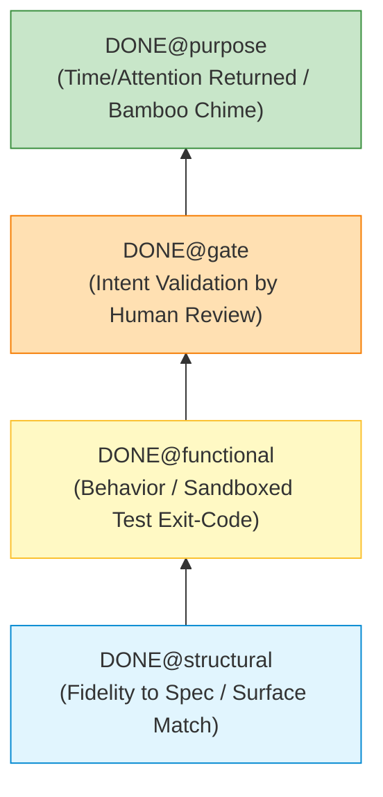

# 02. Foundational Principles and the Stratified DONE Stack
## Non-Negotiable Rules of Evolutionary Empirical Engineering

---

### 1. The Stratified DONE Stack
In EEEMIAD, **it is strictly prohibited to declare a task as "done" without a qualifying tier**.
A naked "done" invites downstream consumers to assume that the system works in the physical world—the genesis of all compounding agentic technical debt.

| DONE Tier | What it Claims | Evaluator | Machine-Measurable? |
|---|---|---|:---:|
| **`DONE@structural`** | The code is a faithful topological image of the specification where the spec speaks (endpoints, signatures, types, relational schemas). | Machine (AST / Graph Extractor) | **Yes** |
| **`DONE@functional`** | The behavior is correct where the specification was silent (internal function logic and edge conditions). | Machine (Isolated unit / integration test suite) | **Yes** |
| **`DONE@gate`** | The specification faithfully represents human intent and solves the real problem. | Human (Deliberate gate review) | **No** |
| **`DONE@purpose`** | The system returned real human hours and genuine attention (manifesto criterion). | Human (Physical reality) | **No, by design** |

> [!IMPORTANT]
> **The Epistemological Divide: Verification $\ne$ Validation**
> - **Verification** = *"Did we build the product correctly?"* (Code fidelity to specification). Machines execute this flawlessly.
> - **Validation** = *"Did we build the right product?"* (Specification alignment with human need). Only humans can judge this.
> `verified` **must never wear the badge of** `validated`.

---

### 2. The 8 Foundational Principles of EEEMIAD

#### Principle 1: The System Has No Right to Declare "Done" Beyond the Evidence it Holds
Trust is never assumed; it is **earned and immutably recorded**. An honest truth engine is ultimately an **evidence engine**: a machine that declares exactly what it knows and refuses to round up to "true".

#### Principle 2: Every Criterion Publishes its Fidelity and Boundaries
Every test or validator must formally state what it **guarantees** and what it **does not guarantee**. 
The most perilous quadrant in software engineering is:
$$\text{Danger Zone} = \text{High Decidability} \times \text{Low Fidelity}$$
(A lightning-fast, crisp green test verifying a cosmetic surface or an artificial mock).

#### Principle 3: No Percentages on the Subjective
Subjective criteria must be represented as **attributed judgments** (a named human judge + an explicit evaluation procedure + an immutable timestamp). 
Assigning pseudo-scientific percentages to qualitative facets (e.g., "87% code elegance", "92% usability") is the laundering of subjectivity under a veneer of false rigor.

#### Principle 4: Abstract Only What Has Repeated ($\ge 2$ Times)
It is strictly forbidden to build generic frameworks, predictive middlewares, or speculative database schemas for hypothetical use cases. Abstraction is justified only when the observed pattern has **manifested at least twice across distinct functional slices**.

#### Principle 5: Automate Only What is Stable
Do not write sophisticated CI/CD pipelines, autonomous generators, or complex sync tasks for business flows or data schemas that are still undergoing rapid churn in Phase 3 (POC). Automating the unstable generates compounding maintenance friction.

#### Principle 6: Continuous Evolution Driven by Real Runtime Feedback
No architectural hypothesis survives production unscathed. When telemetry from the cluster (*reality*) contradicts a theoretical claim in the *Plan*, reality governs: a formal upward reconciliation ritual via ADR is initiated.

#### Principle 7: Implicit Contracts are Prohibited (§7 Explicit Contract Registry)
Every service boundary must maintain an explicit contract registry covering:
1. Security invariants (least privilege, tenant isolation).
2. Audit provenance (caller identity, on-behalf delegations, authorization authority).
3. Pre-conditions and post-conditions.
4. Concurrency semantics (write locks, isolation levels).
5. Failure modes (The M11 Table).

#### Principle 8: Closure-by-Re-evaluation Doctrine
No engineering task can be closed on the agent's self-report ("I have implemented the requested routes"). Closure strictly requires the automated re-execution of the canonical query or verification harness that originally surfaced the deficit:
$$\text{Legitimate Closure} \iff \text{DeficitQuery}(\text{TargetSystem}) == 0$$
