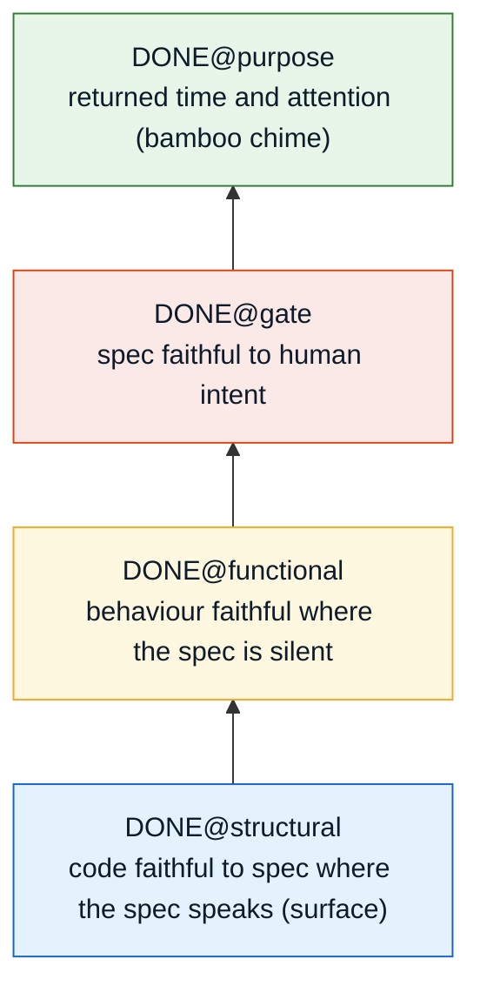

# 🏛️ 02 · Principles and the DONE Stack

*The non-negotiable rules of Evolutionary Empirical Engineering*

---

## 1. The stratified DONE stack

In EEE, **declaring a task "done" without a qualifier is forbidden**. A bare `closed` invites the downstream reader to complete it with "it works": the lie nailed into the mechanism.

| Tier | What it claims | Who judges | Machine-measurable? |
|---|---|---|:---:|
| `DONE@structural` | The code is a topologically faithful image of the spec where the spec manifests: routes, signatures, types, constraints. | Machine (AST extractor, graph) | Yes (topological) |
| `DONE@functional` | Behaviour is faithful where the spec is silent: function bodies. | Machine (isolated tests) | Yes (exit code) |
| `DONE@gate` | The spec is faithful to intent and solves the real need. | Human (deliberate review) | No |
| `DONE@purpose` | The system returned quality human hours and attention. | Human (real life) | **No, by design** |

> [!IMPORTANT]
> **Verification ≠ Validation.**
> *Verification* answers "did we build it right?" (code faithful to spec); the machine does it.
> *Validation* answers "did we build the right thing?" (spec faithful to intent); only the human does it.
> `verified` **never wears the badge of** `validated`. The apex of the stack is machine-immeasurable on purpose: the honesty of the lower tiers exists so the human spends judgement only at the top.

### Why the functional test is a crutch

"Structural = correct" only holds if the materializer is trustworthy. A compiler earns that trust (deterministic, proven). An LLM does not: it can emit a surface that matches the spec and a body that does something else. The functional test is necessary **exactly to the extent that the spec under-determines the program**. As the spec gains truth (pre- and post-conditions, types, cardinalities), the crutch shrinks.

### Verification mode per guarantee

Every guarantee carries a **mode**, and the mode limits the DONE tier it can reach:

| Mode | What it is | Maximum tier |
|---|---|---|
| **Deterministic** | Exact match; passed = has the property. | crisp `DONE@functional` |
| **Threshold + confidence** | Statistical gate with a band (e.g. Wilson lower bound). Honest only with the confidence declared; never "100%". | `DONE@functional` with band |
| **Shape / judgement** | Fuzzy, attributed to a named judge. | `DONE@gate` |

Granularity is mode: **slice until the piece is deterministic; the residue that does not reduce is the irreducible subjective**, and receives an attributed judge, never an exact number.

## 2. The six principles of DONE

Crystallized in the canonical document *Truth, the Materializer and DONE*:

1. **DONE is stratified and self-declaring.** Always `done@tier`, never a bare "done".
2. **Every criterion publishes its fidelity, not only its verdict.** A check says what passing it guarantees **and what it does not**. The dangerous quadrant is *high decidability with low fidelity*: a crisp green that does not deliver.
3. **No percentages on the subjective.** A subjective criterion is an **attributed judgement** (judge, procedure, timestamp), not a number. "87% usability" is subjectivity laundered with a veneer of rigour.
4. **DONE scales with risk.** The evidence bar is a function of the cost of being wrong. Declare the bet the criterion was calibrated for: a prototype is not a pacemaker.
5. **DONE is defeasible.** It means "no defect found by battery B up to instant t", never "correct". You prove *not-done* (a test fails); you never prove *done*. Regression tests are how a DONE bet becomes durable.
6. **Separate construction from validation.** "Built right" (closure) and "was the right thing" (gate) do not swap badges.

## 3. The five principles of evolution

The principles that make EEE **evolutionary**, extracted from practice across successive arcs:

7. **Abstract only what has repeated (≥ 2 times).** Building frameworks, generic middleware or cross-cutting tables for hypothetical scenarios is forbidden. Abstraction is justified only when the same divergence or repetition has been **observed in at least two distinct slices** (Phase 6).
8. **Automate only what is stable.** Sophisticated pipelines and autonomous generators are not written for contracts still changing every slice. Automating the unstable multiplies maintenance.
9. **Runtime reality prevails over the plan's hypothesis.** When the observed contradicts the planned, the rite of **upward reconciliation** via ADR begins. The spec is never adjusted to forgive the code.
10. **Implicit contracts are forbidden.** Every interface keeps an explicit register of: security invariants, audit trail (who called, on whose behalf, under which authority), pre- and post-conditions, concurrency and **failure modes** (M11 matrix). Whoever decides also describes: every table, flag or job created under an ADR enters the spec **in the same arc it is born**.
11. **Closure by re-evaluation.** No task closes on self-report. It closes when the verification (query, test, probe) that **detected the deficit** is re-run and returns zero.

> [!TIP]
> **One sentence to keep:** *measure, don't self-promote*. EEE discipline, "earn trust instead of assuming it" and the bamboo chime are the same truth at different altitudes.

## 4. Watchpoints: what can rot

- **Satisfaction as a stamp.** "The human decides" can degenerate into taste-as-veto. The apex is not "did the operator like it?", but the specific question: *did it return time and attention for what matters?*
- **Construction attention mistaken for the steady state.** Building the platform demands vigilance; using it must not. The day building stops hurting is not the day using stops hurting; only the second fulfils the manifesto.
- **Retrofitting a pretty story.** Marrying a technical thesis to the ethos is pleasant, and therefore suspect. Actively seek the design decision that **contradicts** the manifesto, not only the confirmations.
