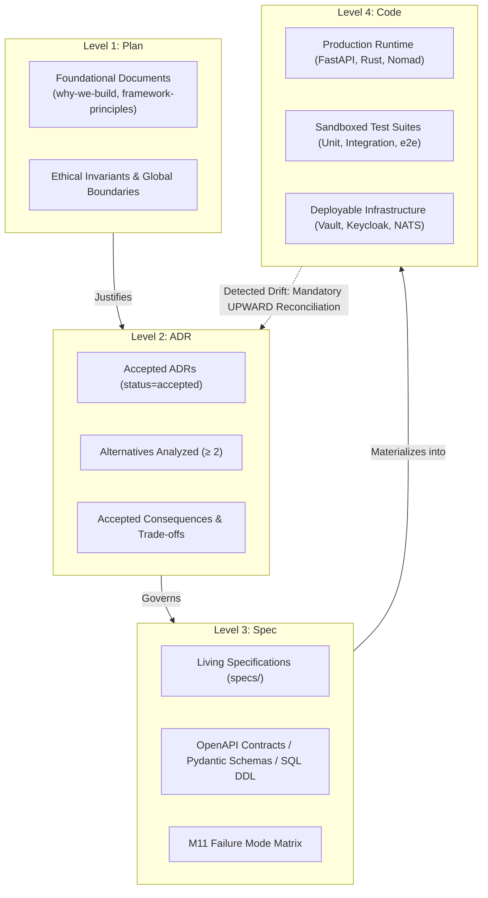

# 03. The Unambiguous Hierarchy of Truth
## The Canonical Cascade Plan → ADR → Spec → Code and Upward Reconciliation

---

### 1. The Structure of the Cascade
In EEEMIAD, system integrity is governed by a strict, one-way cascade of documental authority:

$$\mathbf{Plan} \;\;(\text{Level 1: Intent \& Principles}) \;\;\longrightarrow\;\; \mathbf{ADR} \;\;(\text{Level 2: Architectural Decisions}) \;\;\longrightarrow\;\; \mathbf{Spec} \;\;(\text{Level 3: Formal Contracts}) \;\;\longrightarrow\;\; \mathbf{Code} \;\;(\text{Level 4: Runtime \& Tests})$$

---

### 2. Formal Definition of Each Layer

#### Layer 1: Plan (Intent and Principles)
- **Scope:** Philosophical rationale, ethical boundaries, resource budgets (tokens, CPU time, memory ceilings), and macro architectural vision.
- **Authority:** Dictates what the platform **may and may not do**; remains silent on local implementation details.
- **Lifespan:** Years. Shifts only under major product pivot.

#### Layer 2: ADR (Architectural Decision Records)
- **Scope:** Formal architectural choices adjudicating technical trade-offs.
- **Mandatory Anatomy:** Sequential ID, status lifecycle (`PROPOSED`, `ACCEPTED`, `DEPRECATED`, `SUPERSEDED`), technical context, at least two competing alternatives evaluated with explicit pros/cons, empirical evidence justification, and accepted consequences.
- **Rule:** No decision is born accepted; every draft is created as `PROPOSED`.

#### Layer 3: Spec (Formal Living Specifications)
- **Scope:** The operational machine truth. OpenAPI contracts, JSON schemas, Pydantic models, relational DDL, NATS JetStream subject taxonomies.
- **Invariant:** A specification is a *living document* mirroring exactly what must be materialized. Specifications do not contain messy source code or transient hacks.

#### Layer 4: Code (Runtime Implementation and Tests)
- **Scope:** Executable business logic, database migrations, container job manifests, and verification harnesses.
- **Fidelity:** Code is the **faithful compilation of the specification**, exactly as machine assembly is the faithful compilation of source C.

---

### 3. The Inviolable Arbitration Rule: Upward Reconciliation
When an automated test, reality check, or live incident reveals a divergence between `Code` behavior and `Spec` prescription:

> [!CAUTION]
> **CODE NEVER WINS A DIVERGENCE SIMPLY BECAUSE IT IS ALREADY DEPLOYED.**
> Retroactively altering a specification to excuse an undocumented shortcut in the code is the most dangerous failure mode in AI engineering: **Hierarchy Inversion (Anti-Pattern §6.7 / 10.7)**.

#### The Upward Reconciliation Flow:
1. **Detection and Quarantine:** The Executive Agent or CI test suite surfaces the drift between runtime and specification.
2. **Escalation to Higher Layer:**
   - If the code deviation was a deliberate, stable Phase 3 pragmatism that proved superior in production, **it cannot be silently adopted**.
   - An **ADR Amendment** must be drafted, explicitly arguing why the runtime finding supersedes previous assumptions.
3. **Human Ratification:** The ADR amendment is reviewed and accepted by the operator (`status=accepted`).
4. **Specification Update:** The `Spec` is formally updated to encode the new contract.
5. **Code Harmonization:** Verification tests and code paths are brought into 100% compliance with the updated specification.
