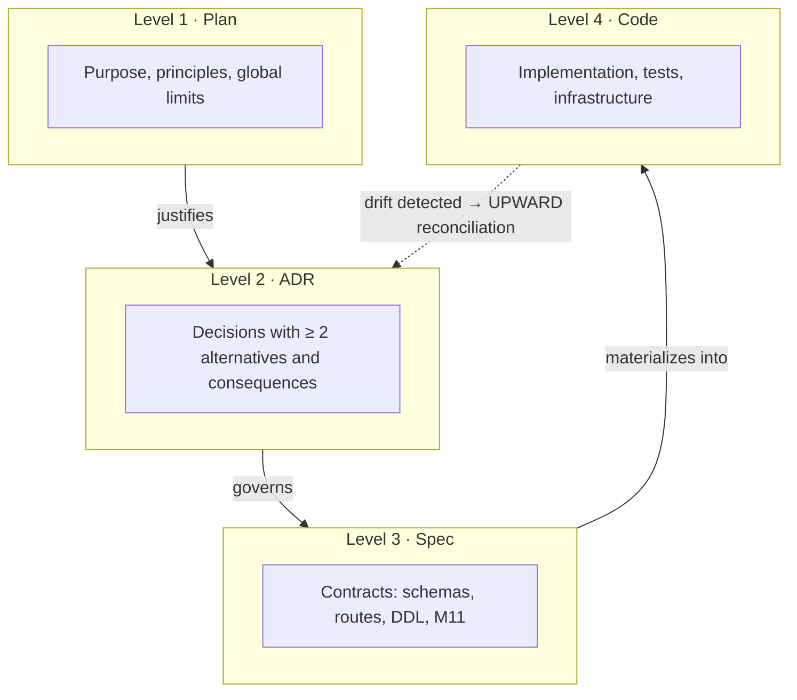

# 🔺 03 · The Unambiguous Hierarchy of Truth

*The cascade Plan → ADR → Spec → Code and upward reconciliation*

---

## 1. The structure of the cascade

The integrity of a system under EEE rests on a one-way hierarchy of documentary authority:

```
Plan  (level 1 · intent and principles)
  └─► ADR  (level 2 · architectural decisions)
        └─► Spec  (level 3 · formal contracts)
              └─► Code  (level 4 · runtime and tests)
```



## 2. Definition of each layer

### Level 1 · Plan (intent and principles)
- **Contains:** purpose, operational limits (budgets, isolation, default failure postures) and the product vision.
- **Authority:** dictates what the system **may and may not** do; silent on implementation.
- **Lifespan:** years. Changes only with a fundamental shift of strategy.

### Level 2 · ADR (architecture decision records)
- **Contains:** the decisions that arbitrate technical choices.
- **Mandatory form:** sequential number; status (`PROPOSED`, `ACCEPTED`, `DEPRECATED`, `SUPERSEDED`); context with empirical origin; **at least two alternatives** with pros and cons; accepted consequences; numbered decisions (D1, D2, ...).
- **Golden rule:** no decision is born accepted. **Whoever proposes does not ratify**: ratification is a separate artefact citing evidence, SHA and proof level.

### Level 3 · Spec (living formal contracts)
- **Contains:** the machine's operational truth: input and output schemas, routes, asynchronous messages, DDL, invariants and the failure-mode matrix (M11).
- **Invariant:** the spec is a *living specification* in parity with what must be materialized. It contains no code or hacks. **An exit criterion that cites an operational limit points to where the limit lives; it does not copy it** (a copied numeric literal diverges on the next deploy, and the divergence resolves silently in favour of the code).

### Level 4 · Code (runtime and implementation)
- **Contains:** executable code, migrations, deployment manifests, test suites.
- **Relation to the spec:** code is the **faithful materialization** of the spec, as a binary is the faithful materialization of source.

## 3. The inviolable rule: upward reconciliation

When a test, a reality-check or an incident detects a discrepancy between what the code does and what the spec prescribes:

> [!CAUTION]
> **Code never wins a divergence by already being deployed.**
> Adjusting the spec's text to conform to the code's shortcut is the gravest methodological violation: **hierarchy inversion**. Corollary: **ADRs are never reconstructed from code**. Code is evidence of what was done, never of what was decided.

### The correct flow

1. **Identify and isolate** the drift, declaring the layer in which it was measured.
2. **Escalate to the higher layer.** If the code's deviation was a Phase 3 pragmatism that proved indispensable at runtime, it is **not approved silently**: an **ADR amendment** (`status=PROPOSED`) is drafted arguing why the observed behaviour is superior to the original contract.
3. **Ratify** in a separate artefact, by whoever decides (human or deciding role), citing the runtime evidence.
4. **Update the spec** to incorporate the new contract.
5. **Harmonize code and tests** against the new spec.
6. **Sweep the dependants.** Correcting a premise requires sweeping every decision that rested on it (Rule R9).

### In a conflict between layers

| Conflict | Who wins |
|---|---|
| Spec ↔ Code | Spec |
| ADR ↔ Spec | ADR |
| Original ADR text ↔ ratified amendment | Amendment |
| Any layer ↔ Plan | Plan |

Every reconciliation declares the **authoritative layer** it confirmed against, and confirms against the **highest** one that speaks on the matter, not one step above the code.

## 4. Illustrative examples (generic)

| Observed divergence | Wrong resolution (inversion) | EEE resolution |
|---|---|---|
| An internal hop between two services accepts tasks without validating a credential; the spec requires a token. | Rewrite the spec saying the internal route is "trusted by network". | Issue an amendment ADR; introduce a service credential; close the route; update the spec to require `Bearer`. |
| A global admin token bypasses all authorization; it "eases operations". | Document the master token as a feature. | ADR removing the token; all administration goes through the authorization policy; migration with a rollback window. |
| The spec says 75 ms timeout; the deployment has run at 500 ms for months without incident. | Set the deploy to 75 ms blindly, or ignore the number. | Measure real latency under load; amend the ADR with the empirical reason; make the spec **point to the source** of the limit instead of copying it. |
| Five tables exist in production and none appears in the database spec. | Treat as an "implementation detail". | Whoever decides also describes: each table enters the spec in the same arc; Phase 8 sweeps parity. |
