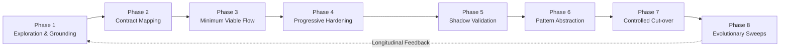

# 04. The Eight Formal Lifecycle Phases
## From Initial Intent to Evolutionary Governance

---

### 1. Overview of the 8 Phases
The EEEMIAD lifecycle structures the progression of any feature, service, or architectural contract through **eight discrete phases**, specifically designed to eliminate the compounding spread of hallucinated code and spec-rot:

---

### 2. Operational Specification per Phase

#### Phase 1: Exploration and Grounding
- **Objective:** Probe technical feasibility and confront human intent against physical cluster reality.
- **Activities:** Network connectivity probes, third-party library benchmarking, API compatibility scans.
- **Isolation Mandate:** Strictly forbidden to commit code directly into production branches. All work is isolated in scratchpad files (`scratch/`) or disposable spikes.

#### Phase 2: Contract and Boundary Mapping
- **Objective:** Establish formal machine interfaces before writing business logic.
- **Activities:** Definition of Pydantic models, OpenAPI specifications, relational DDL with constraints, and drafting the governing ADR (`status=proposed`).
- **Exit Gate:** Schemas validated against Foundational Principles.

#### Phase 3: Minimum Viable Flow (POC / Thin Slice)
- **Objective:** Prove end-to-end integration across the stack with minimal surface code.
- **Activities:** Implementation of the "thin vertical slice", linking input ingress, orchestration, and output delivery.
- **Discipline:** Local pragmatic mocks are permitted, provided they are explicitly categorized and tagged as scaffolding in source code.

#### Phase 4: Progressive Hardening
- **Objective:** Purge temporary Phase 3 scaffolding and reinforce security and error handling.
- **Activities:** Replacing stubs with full implementations, wiring Vault-backed credentials, configuring JWT verification, and cataloging failure behaviors in the M11 Matrix.

#### Phase 5: Shadow Validation (Non-Blocking Observation)
- **Objective:** Observe component behavior under live production workloads without impacting production state.
- **Activities:** Component operates with `shadow=true`. It evaluates live payloads, calculates decisions or scores, and writes to an audit intent-log, while legacy services handle authoritative responses.
- **Minimum Window:** At least 14 to 21 continuous days or a minimum of 5,000 verified samples demonstrating calibration.

#### Phase 6: Pattern Identification and Justified Abstraction
- **Objective:** Harvest lessons and build reusable primitives under Principle 4.
- **Rule:** Only after a pattern or recurring drift has been empirically observed across 2 or more distinct functional slices is a shared library, generic schema, or cross-cutting service authorized.

#### Phase 7: Controlled Cut-over (Transition to Enforce)
- **Objective:** Toggle operational flags from `shadow` to `enforce`.
- **Mandatory Pre-Flight:**
  1. Blast-radius checklist completed.
  2. State prerequisites confirmed in runtime (grants, tables, keys exist before deploy).
  3. Composed gates verified: proving that the combination of multiple flips does not break end-to-end product flows.
  4. Rollback procedure rehearsed and timed.

#### Phase 8: Evolutionary Governance and Sprint-Exit Sweeps
- **Objective:** Maintain zero entropy and prevent the regeneration of technical debt and spec-rot.
- **Ritual Execution:**
  - Automated AST scans detecting dead code, orphan routes, and ghost flags.
  - Bidirectional 1:1 confrontation between code routes and living specifications.
  - ADR status review: proposals older than 30 days are promoted or discarded.
  - Re-execution of the canonical closure-by-re-evaluation test suite.
