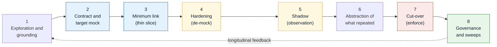

# 🔄 04 · The Eight Phases of the Cycle

*From initial intent to evolutionary governance*

---

## 1. Overview

EEE divides the maturation of any subsystem, contract or feature into **eight progressive phases**. They are not a waterfall: a mature system has subsystems in different phases at the same time, and each **arc** (see [06 · Evolutionary Construction](06-evolutionary-construction.md)) traverses a stretch of them.

## 2. The phases

### Phase 1 · Exploration and grounding
- **Goal:** confront intent with the real terrain; produce the end-to-end system map.
- **Activities:** network and API probes, library inspection, inventory of existing surfaces.
- **Discipline:** nothing goes into the production tree. Drafts live in `scratch/` or in spike branches. Every state claim leaves with its **ground-truth level** declared (Rule R15).

### Phase 2 · Contract and target mock
- **Goal:** fix the interfaces before any business logic, and define **the contract that the mock and the real implementation will both have to satisfy**.
- **Activities:** input and output schemas, DDL with constraints, draft of the governing ADR (`PROPOSED`), first version of the M11 matrix.
- **Exit criterion:** the mock returns **true shapes**, reproducible by the real implementation when it comes in behind. A mock that returns shapes the real one will never produce is debt in disguise.

### Phase 3 · Minimum link (thin vertical slice)
- **Goal:** prove end-to-end coupling with the minimum of code.
- **Activities:** one slice linking input, processing and output, crossing every layer once.
- **Discipline:** local pragmatisms (in-memory stubs, `DRY_RUN=1`) are allowed **as long as they are tagged as such** in the code and in the data they produce. **The mock validates the pipe, not the measurement**: it proves the flow crosses; it does not prove the value is right.

### Phase 4 · Hardening (de-mock)
- **Goal:** replace each stub with the real implementation, one at a time, and harden security and resilience.
- **Activities:** swap development defaults for configuration and secrets from the official source; authentication on internal hops; exception handling; **tabulation of failure modes** (M11) and fault injection to prove each gate's posture.
- **Exit criterion:** no production path depends on a development literal; every remaining stub sits behind a flag with a default of off and a verifiable retirement trigger.

### Phase 5 · Shadow (non-blocking observation)
- **Goal:** measure the new behaviour under real load **without** letting it decide.
- **Activities:** the component runs in `shadow`: it consumes real payloads, computes the decision and records the divergence against the current behaviour in an auditable *intent log*. Without current behaviour (a new system), the comparison is against a **named oracle** ([06 §3](06-evolutionary-construction.md#flags-in-greenfield-no-current-behaviour)).
- **Window:** declared in the arc charter in **real opportunities** (Rule R5), not calendar time alone. "Zero divergences on an insufficient sample" is an inconclusive result, not evidence (R6).
- **Limit of shadow:** it validates *what the new logic computes*; the first *enforce* validates *what to write when reconciling state*. Budget for a reconciliation surprise.

### Phase 6 · Abstraction of what repeated
- **Goal:** name the pattern after it has appeared twice.
- **Rule:** only after observing the same behaviour or the same divergence in **two or more distinct slices** may a library, generic model or cross-cutting table be extracted. Special cases stacked without consolidation are Phase 6 debt; abstraction before the second occurrence is speculation.

### Phase 7 · Controlled cut-over (enforce)
- **Goal:** flip the switch from `shadow` to `enforce`.
- **Mandatory rite (pre-flight):**
  1. **Blast radius** enumerated: what changes beyond the declared target (credentials, cluster state, destructive data).
  2. **Reversible?** If not, stop: it requires an explicit per-action decision.
  3. **Rollback rehearsed** before the flip, with recovery time measured.
  4. **State precondition** verified at the source: tuples, grants, keys and tables exist **before** the deploy (command and observed result).
  5. **Flip composition:** which other gates changed in this window and whether their **product** was exercised end to end (command and result, not inference).
  6. **The mechanism exists:** the `enforce` path is built and syntactically verified; naming the phase in the ADR does not build it (R26).
  7. **Target state covered:** is the target environment in a state the tests never exercised (empty, just migrated, holding old data outside a new rule, a different volume)? If so, run the battery **from that state** before the flip. Each arc is usually tested with data; the target may be empty.
- **After the flip:** a declared observation window before **retiring** the flag.

### Phase 8 · Evolutionary governance and sprint-exit sweeps
- **Goal:** prevent spec-rot from regenerating and keep entropy low.
- **Sprint-exit rite:**
  - AST sweep for dead code, orphan routes and **ghost flags** (declared, zero consumers).
  - Bidirectional 1:1 confrontation between exposed routes and specified routes.
  - **Custody of the decision record:** every cited ADR exists on the main branch; `file:line` anchors resolve to the symbol named beside them (R13, R14).
  - Ageing: decisions in `PROPOSED` beyond the declared window are promoted, amended or cancelled.
  - **Proof test** of contingency mechanisms: handlers whose only organic trigger is the failure they handle are exercised deliberately, on a declared cadence.
  - Re-run of the closure-by-re-evaluation battery, through the project's **single gate**; versions of copied tools checked ([08 §8.3](08-application-guide.md)).
  - **Evidence journal** up to date: every state change of the cycle has a line with command and result; the operational state matches the environment ([08 §8](08-application-guide.md)).

## 3. How the phases fit into an arc

| Stretch of the arc | Phases traversed | Flag |
|---|---|---|
| Charter and contract | 1 → 2 | does not exist yet |
| Thin slice with stubs | 3 | `OFF` (behaviour-neutral) |
| De-mock and M11 | 4 | `OFF` → `SHADOW` |
| Observation | 5 | `SHADOW` |
| Flip | 7 | `ENFORCE` |
| Flag retirement and sweep | 8 (and 6, if it repeated) | removed |
