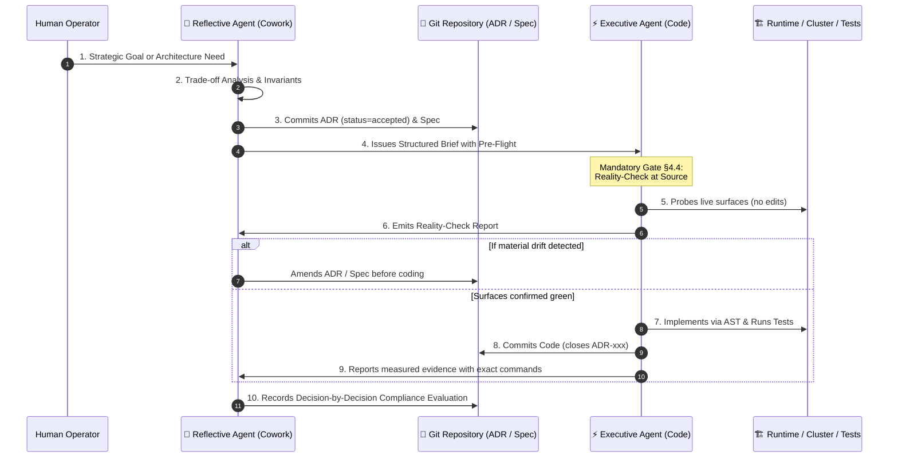

# 06. The Dual-Agent Workflow
## Structural Role Separation: Reflective Mode versus Executive Mode

---

### 1. Premise of Role Specialization
The same frontier language model (e.g., Claude 3.5 Sonnet, Gemini 1.5 Pro, GPT-4o) exhibits radically different operational postures depending on how its session is seeded and governed:
- **Reflective Mode:** Long sessions, architectural exploration, broad cross-cutting context, explicit trade-off debate, skepticism, and decision drafting.
- **Executive Mode:** Tight editing sessions, terminal tooling, surgical diffs, test harness execution, and fast refactoring.

Rather than forcing an agent to be "mediocre at everything", EEEMIAD formalizes a **dual-agent division of labor with an explicit handoff protocol**:



---

### 2. Responsibility Matrix

| Dimension | 🧠 Reflective Agent (Cowork) | ⚡ Executive Agent (Code) |
|---|---|---|
| **Primary Scope** | Architectural decisions, formal ADRs, living specs, product roadmap, and adversarial audits. | Strict implementation of approved specs, isolated unit/integration tests, AST refactoring, migrations. |
| **Operational Posture** | Skeptical, adversarial, reflection before action, explicit surfacing of risks and consequences. | Surgical, disciplined, tool-driven, strictly bounded by measured code evidence. |
| **Write Permissions** | Writes exclusively to `Plan/`, `reality/`, `findings/`, and draft ADRs. **Never edits production code.** | Edits production code, build scripts, deployment manifests, and test suites. |
| **First Session Artifact** | Premise mapping and affected invariant audit. | **Pre-flight Reality-Check (§4.4)** against live code and runtime. |

---

### 3. The Mandatory Reality-Check Gate (§4.4)
An executive coding session **does not start by editing files**. The first mandatory deliverable of the Executive Agent is to prove that every anchor cited in the brief actually exists in the live codebase:
- File paths, line numbers, function names, and database columns are treated as **"hypotheses to verify, never as facts"**.
- If the Executive Agent detects that an intermediate commit moved a function or renamed an endpoint, execution is **immediately halted**: a *Drift Report* is returned to the Reflective Agent.

---

### 4. Blast-Radius Pre-Flight Block (§5.4)
Every implementation brief touching infrastructure, databases, credentials, or core routing must carry this pre-flight block at the top:

```markdown
### Blast Radius (Mandatory Pre-Flight):
1. Side-Effects: What mutates beyond the stated target? (Keys, credentials, clusters, schemas).
2. Reversible? (Yes/No). If no, STOP — requires explicit per-action human authorization.
3. Rehearsed Rollback: Do backup snapshots or prior keys exist BEFORE deployment? Recovery time?
4. Flip Composition: What OTHER gates were flipped in this window? Was the COMPOSED PRODUCT tested?
5. State Precondition: Does this task depend on a tuple, grant, or flag that does not yet exist?
   - Verification command: ______
   - Observed result:     ______
```

---

### 5. Decision-by-Decision Compliance Evaluation
Upon code delivery, the Reflective Agent does not perform a vague PR review. It audits compliance **decision by decision against the accepted ADR**:
- If the ADR contains 7 numbered decisions (D1 to D7), the evaluation artifact must contain 7 rows with typed verdicts:
  - `MET`: Satisfied with file:line or command evidence.
  - `PARTIAL`: Partially satisfied; missing scope is explicitly named.
  - `NOT-MET`: The implementation violated or omitted the decision.
  - `NOT-CERTIFIABLE`: Evaluator cannot reach the environment; inference is prohibited.
