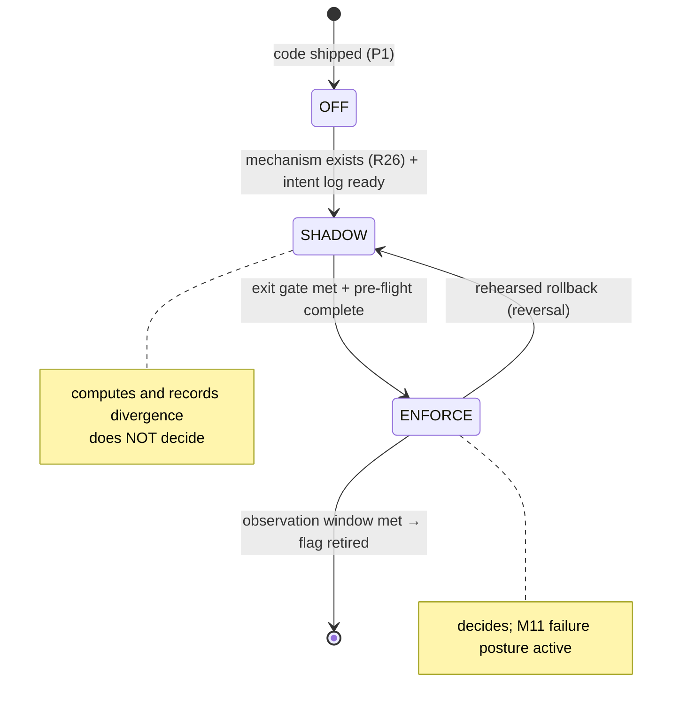

# 🏗️ 06 · Evolutionary Construction: Stubs, Mocks, Flags and Arcs

*How EEE builds: from the empty pipe to enforce, never confusing scaffold with building*

---

## 1. The unit of evolution is the arc

An **arc** is the stretch of work that takes **one property** of the system from "does not exist" to "exists, is on and has been measured", traversing EEE's phases under a flag. An arc **opens with a charter** and **closes with a measurable gate and evidence**, never by declaration.

```mermaid
flowchart LR
    CH["📜 Charter<br/>property +<br/>refutation condition"] --> RC["🔎 Reality-check<br/>is the terrain what<br/>the charter assumes?"]
    RC --> P1["P1 · Thin slice<br/>flag OFF<br/>behaviour-neutral"]
    P1 --> P2["P2 · Shadow<br/>intent log +<br/>divergence detection"]
    P2 --> P3["P3 · Hardening<br/>de-mock + M11 +<br/>fault tests"]
    P3 --> P4["P4 · Cut-over<br/>pre-flight +<br/>flag ENFORCE"]
    P4 --> OBS["⏱️ Observation<br/>declared window"]
    OBS --> RET["🧹 Flag retirement<br/>+ sweep"]
    style CH fill:#e3f2fd,stroke:#1565c0,color:#0d1b2a
    style P4 fill:#fbe9e7,stroke:#d84315,color:#0d1b2a
    style RET fill:#e8f5e9,stroke:#2e7d32,color:#0d1b2a
```



### The charter

The charter is the arc's contract. It specifies **property**, not mechanism (R11):

```markdown
## Charter · <arc name>
- Target property: "no tenant resource read is served without a valid credential"
- Refutation condition: "a request without a bearer that receives 200 refutes the arc"
- Flag: RESOURCE_READ_AUTH_MODE ∈ {off, shadow, enforce} · default in code: off
- Failure posture (M11): authorization dependency unavailable → 503 (fail-closed, loud)
- Exit gate: 0 refutations over ≥ N real opportunities in shadow; live repro at level 4
- Post-enforce observation window before retiring the flag: <declared>
```

Without a refutation condition there is no arc: there is intent.

## 2. Stubs and mocks: scaffolding that declares itself scaffolding

EEE uses stubs and mocks aggressively in Phase 3, under a single rule:

> [!IMPORTANT]
> **The mock validates the pipe, not the measurement.** A stub proves the flow crosses every layer (input → processing → output). It does **not** prove the value is right. Any scaffold output that could be read as a measurement is a plausible answer in the making.

### Distinctions that matter

| Artefact | What it does | What it proves | Typical risk |
|---|---|---|---|
| **Stub** | Returns a fixed or minimal response | The pipe exists and the shape contract is satisfiable | Becoming the production path by omission |
| **Mock** | Records calls and allows asserting interactions | The caller talks to the collaborator as the spec prescribes | Testing the implementation, not the contract |
| **Fake** | Simplified but working implementation (in memory) | Edge behaviour without infrastructure | Silently diverging from the real one |
| **Dry-run** | Executes the real path without effects | The decision logic, without writes | Confusing "what it would compute" with "what it would write" |

### The five scaffold rules

1. **True shapes.** The mock returns shapes the real implementation **will** produce; the contract (Phase 2) is written for both. A mock that invents its own shape is debt.
2. **Tagging in source and in data.** Every stub path is syntactically identifiable (name, module or decorator) and every datum it produces carries provenance (`unknown` or `scaffold`, never `real`). A constant score written by scaffold and read as a measurement is the classic instance of the family.
3. **Behind a flag, default off, explicit value, loud log.** A stub that survives Phase 3 lives behind a flag whose default in code is `off`, with an **explicit** value in the deployment and a log line at boot when it is on. Silent fallback to a stub is fail-open in disguise.
4. **Measured historical radius.** Before de-mocking, measure **how much production data came from the stub** (by sentinel, by provenance). The number enters the arc's closure.
5. **Verifiable retirement trigger.** The stub is removed only when a mechanical command proves nothing consumes it: `grep -rl STUB_FLAG tests/` empty, zero references in the AST. Until then it exists and is documented in the spec (R30).

### De-mock: one collaborator at a time

De-mocking is replacing a stub with the real implementation **without changing the contract**. The order follows dependency and leverage:

1. Configuration and secrets (remove development defaults from the production path).
2. Identity and tenant **from the edge** (never from the payload).
3. External collaborators (model, database, bus).
4. Observability and audit sinks.
5. Removal of mock paths.
6. Flip of `DRY_RUN` to real execution, **gated** by the operator.

Each step is a slice with its own test and the **same** shape contract as the mock. If the real one does not satisfy the contract the mock satisfied, the defect is in the contract or in the real one, never "in the test".

## 3. Flags: the mechanism of controlled evolution

A flag is the **operational anchor** of an arc. It is not a convenience boolean; it is a contract with five mandatory attributes.

| Attribute | Rule |
|---|---|
| **Default in code** | Always the **neutral** behaviour (`off`). New code ships without changing the product. |
| **Value in deployment** | Always **explicit** in the versioned manifest, even when equal to the default. "Absent → default" is state outside the source. |
| **Domain** | `off \| shadow \| enforce` (or `OFF \| ON` for flags without an observation phase). A boolean where there are three states is the family's signature (R1). |
| **Failure posture** | Declared in the M11 matrix: what happens when the dependency falls, per flag state. |
| **Register** | Every flag appears in the **enforcement ledger**: default, value, state, guarantee, posture, ADR. Flip and ledger change **in the same commit**. |

### States and what each guarantees



### Flag pathologies (all measured)

- **Ghost flag:** declared in configuration, **zero consumers** in code. Gives the feeling of control while controlling nothing. Detectable by AST in Phase 8.
- **Non-existent `enforce` path:** the ADR names the phase; the code only emits a *warning*. Flipping changes nothing but verbosity (R26).
- **State outside the source:** a flag flipped by hand at runtime; a redeploy reverts it silently. *If it governs behaviour, it lives in the source.*
- **Collapsed tri-state:** an unavailable dependency returning `401` instead of `503`. The client reads "invalid credential" when the truth is "could not verify".
- **Unexercised composition:** three correct flips in the same window, each with its own pre-flight, **none with a pre-flight of the product**. The second breaks the path through which the third asks its question.
- **Shadow measuring the wrong delta:** shadow computes *new logic − old logic*; the first *enforce* reconciles *new logic − real state*. They are different deltas; the second brings surprises the first structurally cannot see.

## 4. Test integration along the arc

An arc's tests are not a phase; they are the **evidence trail** that accompanies each step.

### The disagreeable pair in every battery (R2)

```
(1) the target case, previously barred   → passes   (the change worked)
(2) what already passed                  → passes   (legacy not broken)
(3) the NEIGHBOUR that must stay barred  → BARS     (the loosening did not leak)
```

Without (3), an accidental loosening produces exactly the same green. The rule holds with double force on changes that **widen** validation: that is the direction in which gate instinct does not protect, because everything starts passing.

### Test first, and red before green

The target case's test is written **before** the code and must **fail** for the right reason. A test born green has measured nothing: *probe-and-revert* (inject the exact defect, confirm the red, revert) is mandatory before accepting the green.

### Debt declared as a test (R29b)

When a property does not yet hold (for example, "policy mutation requires a credential" in P1), it enters the battery as a negative assertion marked `xfail(strict=True)`. The test documents the debt **and** announces its settlement: when the property is implemented, it turns `XPASS` and fails the suite, forcing its promotion to a normal test. In arcs where instruments lied, it was the only mechanism that announced good news nobody asked for.

### Fault injection for every M11 row

For each gate, the battery proves the declared posture under dependency failure: unavailable, timeout, `5xx`, invalid body, empty configuration. On a decision gate **all** must deny (fail-closed) and log loudly; on an evidence sink **none** may discard the record (fail-open with durable buffer, R7). The happy path stays green beside them, as a control.

### Independence at the functional tier

When the same author (human or model) writes spec, code and test, **consistently wrong** cases pass verification and stay invisible inside "verified". In an experimental loop with single authorship, the rate of "verified by execution" sat around 0.51 (95% CI 0.41–0.62) and rose to about 0.62 (95% CI 0.53–0.71) when types were pinned in the spec; and that number is an **upper bound** of real correctness, inflated by self-consistent wrong cases of unknown size. Only independent or blind authorship sees that ceiling. That is why the role **who verifies** generates tests from the spec and the M11, without reading the implementation.

### Proof level at closure (R15)

The arc's closure declares the level at which each claim was proven. A whole ledger at level 1 (versioned file) with real deploys proven at level 4 (live reproduction) is honest; a ledger that does not declare a level is read as 4 and is usually 1.

## 5. Evolutionary expansion

The arc does not end at `enforce`. It ends when the flag has been **retired** after the declared window, the spec describes what exists (R30), and the Phase 8 sweep finds no ghosts. From there, three movements sustain growth:

1. **Raise one predicate per arc.** Each arc chooses the next behavioural predicate to rise from improvisation into the spec (a pinned type, a post-condition, a cardinality). The functional crutch shrinks one step.
2. **Abstract on the second occurrence.** When the same gate, flag or reconciliation pattern appears in two slices, it is named and extracted (Phase 6). Before that, repeating is cheaper than getting the abstraction wrong.
3. **Automate what stopped changing.** Sweeps, ledgers and closure queries become scripts once the contract they verify has stabilized. Automating the unstable multiplies maintenance.

> [!TIP]
> **Rule of thumb for budgeting an arc:** the number of code-free round trips scales with the **blast radius**. Reading and reversible scratch: go, fail cheaply. Irreversible, production, credentials: full certainty before touching. "Better ten trips without code than one trip with code and ten correction trips." Do not confuse with paralysis on reversible things.

## 6. Runnable example

The directory [`examples/evolutionary-arc/`](../../examples/evolutionary-arc/README.md) contains a complete arc in pure Python: an **audit sink** born as a stub behind `AUDIT_SINK_MODE=off`, passing through `shadow` (computes and records divergence without deciding) and reaching `enforce` with an M11 posture of fail-open with a durable buffer. The battery shows the disagreeable pair, the debt in `xfail(strict)`, fault injection and the control against loosening. No external dependencies.
