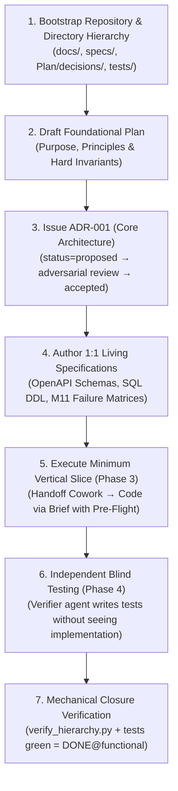
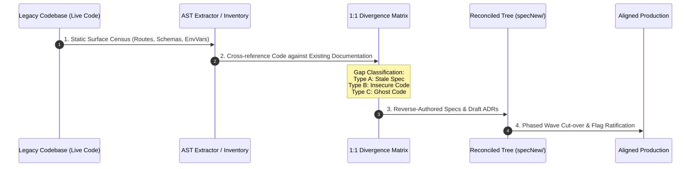

# 08. Step-by-Step Practical Application Guide
## Adopting EEEMIAD in Greenfield and Brownfield Codebases

---

### 1. Greenfield Projects



#### Step 1: Initialize Governance Hierarchy
Initialize the standard directory layout:
```bash
mkdir -p Plan/decisions specs tests/unit tests/integration tests/adversarial
```

#### Step 2: The First Dual-Agent Handoff
1. The **Reflective Agent (Cowork)** produces the foundational specification and initial ADR.
2. The **Human Operator** ratifies the decision (`status=accepted`).
3. Cowork issues the **Executive Brief** using `templates/en/brief-template.md`.
4. The **Executive Agent (Code)** performs the pre-flight Reality-Check, compiles the implementation, and opens a Pull Request tagged `closes ADR-001`.

---

### 2. Brownfield Projects

Adopting EEEMIAD across a large legacy codebase requires reverse-engineering and progressive reconciliation across **4 Stages**:



#### Stage 1: Static Inventory and Surface Census
- Extract via AST all HTTP route handlers actively bound in controllers.
- Enumerate live tables, columns, and foreign keys in databases.
- Map all environment variables consumed across application services.

#### Stage 2: The Double-Entry Divergence Ledger
Map structural modules against behavioral axes (Identity, Auth, Orchestration, Audit). Classify gaps:
- **Type A (Stale Spec):** Code evolved legitimately, but spec lagged behind $\to$ Update spec to mirror reality.
- **Type B (Defective / Insecure Code):** Code took unauthorized shortcuts or silent fail-opens $\to$ Schedule code fix.
- **Type C (Ghost / Dead Code):** Orphan routes and unreferenced tables $\to$ Cleanly excise.

#### Stage 3: Isolation in `specNew/`
Do not mutate the living documentation of the legacy system while conducting the census. Author reconciled specifications in an isolated directory (`specNew/`) until achieving **strict 1:1 parity with measured runtime**.

#### Stage 4: Cut-Over and Enforcement
Promote `specNew/` to authoritative status and execute phased cut-overs from `shadow` to `enforce`.

---

### 3. The Phase 8 Ritual: Sprint-Exit Sweep
At the conclusion of each development milestone:
1. Run the verification harness: `python3 examples/verification-harness/verify_hierarchy.py`.
2. Inspect decisions lingering in `status=proposed` for over 15 days.
3. Review the unexercised test ratio (Rule R6).
4. Verify that new routes possess explicit entries in the M11 Failure Mode Matrix.
