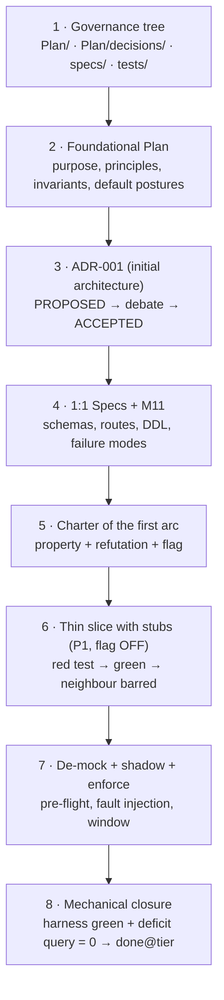
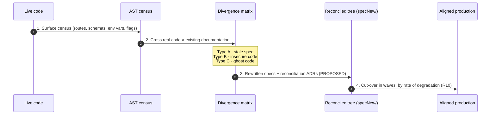

# 🛠️ 08 · Practical Application Guide

*How to adopt EEE in new and legacy projects, in objective steps*

> [!NOTE]
> This chapter is deliberately operational. The rationale is in [02](02-principles.md), [05](05-refinement-rules.md) and [09](09-academic-foundation.md); here there is only what to do, in which order, and how to know it is finished.

---

## 1. New project (greenfield)



### Step 1 · Governance tree

```bash
mkdir -p Plan/decisions Plan/docs specs tests/unit tests/integration tests/adversarial
```

| Directory | Layer | Content |
|---|---|---|
| `Plan/docs/` | 1 | Purpose, principles, invariants, limits |
| `Plan/decisions/` | 2 | Numbered ADRs ([template](../../templates/en/adr-template.md)) |
| `specs/` | 3 | Living contracts + M11 matrix ([template](../../templates/en/failure-modes-m11-template.md)) + flag ledger ([template](../../templates/en/flag-ledger-template.md)) |
| `tests/` | 4 | Suites with disagreeable pairs; `adversarial/` is written without reading the implementation |

### Step 2 · Foundational Plan
One page. Contains: why the system exists; what it **must not** do; default failure postures (decision → fail-closed; evidence → durable fail-open); global budgets.

### Step 3 · ADR-001
Born `PROPOSED`. Has ≥ 2 alternatives, consequences and numbered decisions (D1...Dn). Ratification is a separate commit citing Phase 1 evidence.

### Step 4 · Specs and M11
For each interface: input and output schema, response codes, pre- and post-conditions, and **one M11 row per failure mode**. A spec without M11 is not complete.

### Step 5 · Charter of the first arc
Use the [charter template](../../templates/en/arc-charter-template.md). Property, refutation condition, flag with domain and default, exit gate in real opportunities, observation window.

### Step 6 · Thin slice (P1)
- Flag `off` in code, explicit in the deployment.
- Stubs tagged and with provenance `unknown`.
- Minimum battery: (1) target passes, (2) legacy passes, (3) neighbour bars. Debts in `xfail(strict=True)`.
- **Before accepting the green:** inject the defect and see the red.

### Step 7 · De-mock, shadow and enforce
- De-mock one collaborator at a time, keeping the shape contract.
- `shadow`: intent log + divergence detection + exit-criterion endpoint.
- `enforce` only with a complete pre-flight ([04 · Phase 7](04-cycle-phases.md)); flip and ledger in the same commit.
- Fault injection for every M11 row (unavailable, timeout, 5xx, invalid body, empty config).

### Step 8 · Mechanical closure

```bash
python3 examples/verification-harness/verify_hierarchy.py --project-root .
python3 examples/verification-harness/check_falsification.py --test-dir ./tests
```

Closes when: harness green; the query that detected the deficit returns zero; the tier is declared (`done@functional`, R15 proof level). Anything above that is `done@gate` and belongs to the human.

> [!IMPORTANT]
> **Read the `examined` line, not only the verdict.** The verifier fails when it finds no code to examine; in Phase 2, before code exists, pass `--allow-missing-code`. A verifier that examines nothing must not say it passed. TypeScript/Next.js projects use the [TypeScript adapter](../../examples/verification-harness/typescript/README.md); other languages need an adapter that keeps the same contract.

## 2. Legacy project (brownfield)

Adopting EEE on existing code is reverse engineering in **four stages**, with one rule: **do not edit the living spec while the census is in progress**.



### Stage 1 · Static census
Extract via AST (never grep) every exposed route, active table and column, environment variable read and flag declared. Record, for each item, the **ground-truth level** (R15).

### Stage 2 · Divergence matrix
Cross each module against the behavioural axes (identity, authorization, orchestration, audit) and classify:

| Type | Meaning | Action |
|---|---|---|
| **A · Stale spec** | Code evolved legitimately; the document lagged. | Update the spec, with a reconciliation ADR if the decision changed. |
| **B · Insecure or defective code** | Shortcuts, undue fail-opens, identity read from the payload. | Plan the fix as an arc, ordered by R10. |
| **C · Ghost code** | Routes, stubs and flags with no consumer. | Clean removal after proof of zero consumers. |

### Stage 3 · Isolated tree
Build the reconciled specs in `specNew/` until 1:1 parity with the **measured** code. Each Type B divergence becomes an arc charter with a flag.

### Stage 4 · Cut-over in waves
Promote `specNew/` to official; execute the arcs in waves, each from `off` to `enforce` with its pre-flight. **The first arc must be the one that degrades fastest while waiting**, not the "gravest" on paper.

## 3. Arc conduct checklist

Printable. An arc is complete when every line has evidence (command + result, not inference).

```markdown
### Opening
- [ ] Charter with property, refutation condition, flag (domain + default), M11 posture, exit gate, window
- [ ] Reality-check of the terrain: anchors verified by symbol (R14), proof level declared (R15)
- [ ] Mechanism of each phase exists in the code before being briefed (R26)
- [ ] Context-level division asked to the operator and recorded (`delegation: none | tiered`, [§6](#6-task-division-by-context-level-optional))
- [ ] Private real data? Census of **shape** only (counts, formats, cardinalities), synthetic base with provenance `synthetic`, and a scan of the real data's sentinels over the repository = 0 before the first commit (anonymization gate)

### P1 · Thin slice (flag OFF)
- [ ] Stubs tagged in source; scaffold data with provenance `unknown`, `scaffold` or `synthetic` (never `real`)
- [ ] Target test red → green; legacy green; neighbour barred (R2)
- [ ] Debts recorded in xfail(strict=True) (R29b)
- [ ] Flag in the ledger; spec describes what was created (R30)

### P2 · Shadow
- [ ] Intent log with disagreeable pair (computed × current)
- [ ] Divergence detection and queryable exit criterion
- [ ] Window measured in real opportunities (R5, R6)

### P3 · Hardening
- [ ] One collaborator de-mocked at a time, shape contract preserved
- [ ] One M11 row per failure mode, each with an injection test
- [ ] Stub's historical radius measured; verifiable retirement trigger

### P4 · Cut-over
- [ ] Pre-flight: blast radius · reversible? · rehearsed rollback · state precondition · flip composition
- [ ] Deployment artifact exercised end to end before the flip (level 3b)
- [ ] Flip and ledger in the same commit; explicit value in the deployment
- [ ] Live reproduction of the property and of the refutation (level 4), recorded in the [cut-over evidence template](../../templates/en/cutover-evidence-template.md)

### Closure
- [ ] Deficit query = 0; harness green
- [ ] done@tier declared, with proof level
- [ ] Post-enforce window met → flag retired; Phase 8 sweep finds no ghosts
```

## 4. The Phase 8 ritual (sprint exit)

1. Run the harness and the sweep: `verify_hierarchy.py`, `check_falsification.py`, `sweep_codebase.py`.
2. Bidirectional parity routes ↔ specs; flags ↔ ledger; tables ↔ database spec.
3. Custody: cited ADRs exist on the main branch; anchors resolve to symbols.
4. `PROPOSED` ageing beyond the declared window: promote, amend or cancel.
5. Proportion of unexercised gates (R6) and **proof test** of contingency mechanisms on cadence.
6. Re-run the closure-by-re-evaluation battery.
7. **Executor change** (person, agent or model): before accepting any earlier report, the new executor re-runs the whole battery from the repository. Any divergence between report and re-run goes to the ledger, even a small one: it is the plausible answer in miniature.

## 5. Adopting with AI agents

EEE is tool-agnostic; the harness is not. It reads Python through the AST and TypeScript/Next.js through an [adapter](../../examples/verification-harness/typescript/README.md); for another language, write an adapter with the same contract before trusting its verdict. Two attachment points:

- **Skills:** [`eee-governance-sweep`](../../skills/eee-governance-sweep/SKILL.md) automates Phase 8; [`eee-adversarial-verifier`](../../skills/eee-adversarial-verifier/SKILL.md) instantiates the role *who verifies* (tests from the spec, without reading the code).
- **Role division between agents:** the full instantiation with two agents (reflective and executive), with brief, pre-flight reality-check and decision-by-decision evaluation, is in the sibling repository `EEEMIAD-dual`.

## 6. Task division by context level (optional)

> [!NOTE]
> **Optional and off by default.** It is used only when the operator answers **yes** to the question of the questions phase (below). Without that answer the arc proceeds as in sections 1 to 4. The instantiation with agents and language models lives in the sibling repository `EEEMIAD-dual`; this section holds only the tool-neutral principle.

The idea: EEE's expensive work is **closing** a task (charter, spec, M11). A closed task can be executed by a narrower executor and checked by another, of intermediate reach, **against a mechanical gate**. The system level keeps what requires a decision.

### The question (questions phase, before the first charter)

The deciding role asks the operator, once per project or per arc, and records the answer in the charter (`delegation`):

> *"Adopt task division by context level in this arc? Local tasks with a mechanical gate will be executed by a narrower executor and checked by another, escalating after two failures. Extra cost: writing one packet per task."*

| Answer | Effect |
|---|---|
| **yes** | `delegation: tiered` in the charter; tasks dispatched as a [task packet](../../templates/en/task-packet-template.md) |
| **no** (or no answer) | `delegation: none`; nothing in this section applies |

### The three levels and the classification rule

| Level | Must read | Examples | Executes | Checks |
|---|---|---|---|---|
| **Local** | one spec section and up to two files | generate DDL from the spec, one test for an M11 row, fill evidence from command output, translation, formatting | narrower executor | intermediate, **against the gate** |
| **Module** | one charter, its spec and the module's code | P1 to P3 of an arc, independent oracle, end-to-end tests, deploy manifests | intermediate | system, at the gates (probe-and-revert, pair 3) |
| **System** | Plan, ADRs, several specs and history | census, ADRs, charter property and refutation, cross-layer conflicts, pre-flight, reports | system | **the human** (`done@gate`) |

The rule, in order: needs a **decision** → system. Reads **more than one module** → module. **Has no mechanical gate** → cannot be local. Everything else is local.

### Four operating rules

1. **Blind checking.** The checker receives the packet, the output and the gate; never the executor's reasoning. It runs the gate before reading the output.
2. **Escalation on failure.** Two gate failures move the task up one level. Repeated failure at a level means the packet was not closed: the defect goes back to the system level as a spec defect.
3. **Oracle by another author.** An arc's oracle is written by an executor other than the implementer (another model, language or person). Cheap, and it reduces correlated error.
4. **Measure, don't assume.** Each packet's record (gate on first attempt, escalations, cost) is what tells whether the division saves anything. If the local level's escalation rate exceeds the limit declared in the charter, the classification rule is wrong.
