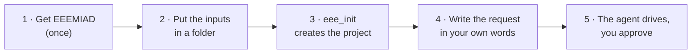

# 🚀 12 · Getting started: a new project with EEE

*For whoever wants to start a project with EEE without reading the eleven chapters first. One command creates the whole project; a coding agent drives the stages; you decide and approve. (PT: [Primeiros passos](../pt/12-primeiros-passos.md))*

---

## Overview



You copy no file by hand. The `starter/eee_init.py` script creates the folders, copies the EEEMIAD templates and verifiers, writes the initial documents already named after the project, registers the inputs and makes the first commit.

## 0. What you need

| Tool | What for | How to check |
|---|---|---|
| git | get EEEMIAD and version the project | `git --version` |
| Python 3.8 or newer | the script and the verifiers | `python3 --version` |
| bash | the gate command (`tools/gate.sh`) | Linux and macOS have it; on Windows use Git Bash or WSL |
| A coding agent (recommended) | to drive the stages with you | Claude Code, Codex, Cursor or any other that reads `AGENTS.md` |

If your machine's `python3` is old, use the path of a newer one instead (e.g. `python3.11`).

## 1. Get EEEMIAD (once)

Outside the project folder, in a fixed place:

```bash
git clone https://github.com/fuzaro/EEEMIAD.git ~/EEEMIAD
```

Already have it? Update: `git -C ~/EEEMIAD pull`.

## 2. Put the inputs in a folder

Put in one folder everything that already exists about the system: database layout, screens, UX template, screenshots of the old system, sample spreadsheets.

- **No real data:** the script copies the folder into the project (`Plan/docs/inputs/`).
- **Real or private data** (names, e-mails, production records): answer **yes** when the script asks, or pass `--private`. The files stay where they are; the project keeps only the inventory (name, size and hash of each file) and where the folder is.

## 3. Create the project

```bash
python3 ~/EEEMIAD/starter/eee_init.py ~/projects/my-system --lang en --inputs ~/my-system-inputs
```

The script asks for the project name, one sentence about it and whether the inputs are private. To skip the questions, pass everything on the command line:

```bash
python3 ~/EEEMIAD/starter/eee_init.py ~/projects/my-system --lang en \
  --name "My System" --description "Tracks X for team Y." \
  --inputs ~/my-system-inputs --private --stack ts --yes
```

| Option | Effect |
|---|---|
| `--name` | project name (default: the folder name) |
| `--description` | one sentence: what the system does and for whom |
| `--inputs FOLDER` | the inputs folder |
| `--private` | inputs hold real data: inventory, never copy |
| `--stack py` or `ts` | verifiers for Python or for Next.js/TypeScript (default: `py`); changeable later in `tools/gate.env` |
| `--lang en` | documents in English (default: `pt`) |
| `--no-git` | do not create the git repository |
| `--yes` | ask nothing |

The script never overwrites an existing file and refuses a folder that already has an `AGENTS.md`.

### What was created

```text
my-system/
├── AGENTS.md                  ← start here: rules, reading order, commands (people and agents)
├── CLAUDE.md                  ← Claude Code adapter: only points to AGENTS.md
├── Plan/
│   ├── docs/
│   │   ├── request.md         ← what was asked, in your words + question phase
│   │   ├── request-matrix.md  ← each request item → the arc that delivers it
│   │   ├── principles.md      ← the Plan: one page (why it exists, what it must not do)
│   │   └── inputs/            ← your inputs (or only the inventory, if private)
│   └── decisions/             ← ADRs (architecture decisions)
├── specs/charters/            ← specs and arc charters
├── tests/{unit,integration,adversarial}/
├── eee/
│   ├── state/STATE.md         ← state and pending items (the list of what to do now)
│   ├── state/decisions-operator.md ← your fixed decisions
│   ├── log.md                 ← evidence journal (entry 1 is already there)
│   └── kit/                   ← EEEMIAD templates, with origin and version (VERSION)
└── tools/gate.sh              ← the one verification command (configured in tools/gate.env)
```

> [!NOTE]
> **The gate starts red, and that is expected.** At the end the script runs `tools/gate.sh` once: the hierarchy passes and the R2 step fails with *No tests found*. EEE does not let anyone say "done" without evidence; the red goes away once the first test exists (stage 5, arc P1). The result is recorded in entry 1 of `eee/log.md`.

## 4. Write the request

Open `Plan/docs/request.md` and paste in section 1 what you want, **in your own words**: the message, e-mail or text that describes the system. Do not summarise and do not try to make it "nice". This is the one file only you can write; everything else starts from it.

Section 2 holds the questions that need an answer before the first architecture decision. You can answer them yourself or let the agent ask (next stage).

## 5. Drive with an agent

Open the coding agent **in the project folder**. It reads `AGENTS.md` and `eee/state/STATE.md` and knows where the project stands. At each stage, paste the text in the middle column and do what the right column says.

| Stage | What to paste to the agent | What you do |
|---|---|---|
| **A · Foundation** | *Read AGENTS.md and eee/state/STATE.md. We are in the EEE foundation phase. Run the question phase of Plan/docs/request.md with me, one question at a time, and record the answers. Then read the inputs, write Plan/docs/principles.md and the request × arc matrix, and stop for my approval. Do not write code.* | Answer the questions. Read the Plan (one page) and approve it or ask for changes. |
| **B · Decisions** | *Write the ADRs from the approved Plan and the inputs (architecture, data model from the database layout, interface from the UX template), all PROPOSED, with at least two alternatives each. Stop for my ratification.* | Read each ADR and say "accepted" or what to change. Ratification is a separate commit. |
| **C · Contracts** | *Write the specs governed by the accepted ADRs (database DDL, screens, routes), each with its M11 failure-mode matrix, and the flag ledger. Run tools/gate.sh and show the result.* | Check that the screens and the database match what you expect. |
| **D · First arc** | *Open the charter of the first arc with eee/kit/templates/arc-charter-template.md, starting with the matrix item that degrades fastest while waiting. Show the property and the refutation condition before coding.* | Approve the charter. |
| **E · Build** | *Run the arc from P1 to P4 per EEEMIAD ch. 08 §3: red test before green, disagreeable pair, probe-and-revert, flag off → shadow → enforce, a line in eee/log.md for each change. Stop before any write to a shared environment.* | Authorise flips and deploys. Close the arc (`done@gate`). |

After the first arc, repeat **D** and **E** for the next matrix item.

> [!TIP]
> **What is yours and what is the agent's.** The agent writes and verifies; you **decide**: approve the Plan, ratify ADRs, open arcs, authorise writes to shared environments and close `done@gate`. If the agent says "done" without showing the command and the result, ask for both.

## 6. The routine

| When | What |
|---|---|
| Before starting the day | Read `eee/state/STATE.md` (pending items) |
| After any change | `tools/gate.sh` (one command, one exit code) |
| At each decision of yours | A row in `eee/state/decisions-operator.md`, dated |
| At each state change (arc, flip, deploy, incident) | A row in `eee/log.md`, in the same commit |
| A new request | A row in `request.md` §3 and a new item in the matrix |

## 7. Common problems

| Symptom | Cause and fix |
|---|---|
| `Python >= 3.8 required` (exit 3) | Old Python. Run with a newer one: `python3.11 ~/EEEMIAD/starter/eee_init.py ...` |
| `refused: ... already has an AGENTS.md` (exit 2) | The folder is already an EEE project. Choose another folder. |
| `the commit failed` | git does not know who you are: `git config --global user.name "Your Name"` and `git config --global user.email ...`, then `git commit -m "start"` in the project folder. |
| Gate with `FAILED: 1 step(s)` right at the start | Expected: there is no test yet (section 3, note). |
| `tools/gate.sh` does not run on Windows | Use Git Bash or WSL. |
| I want the kit of a newer EEEMIAD | Running the script again overwrites nothing. Update with `git pull` in EEEMIAD, copy the changed files into `eee/kit/` and `tools/eee/`, update `eee/kit/VERSION` and record it in the journal. |

## 8. When to read the rest

You do not need to read everything before starting. Read when the stage asks for it:

- Stages A–C: [08 §1 · New project](08-application-guide.md#1-new-project-greenfield) and [03 · Hierarchy of Truth](03-hierarchy-of-truth.md).
- Stages D–E: [08 §3 · Arc checklist](08-application-guide.md) and [06 · Evolutionary Construction](06-evolutionary-construction.md).
- If the inputs describe a system that already exists: [08 §2 · Legacy project](08-application-guide.md).
- To work with two agents or split tasks by context level: the sibling repository EEEMIAD-dual.
- New terms: [11 · Glossary](11-glossary.md).
