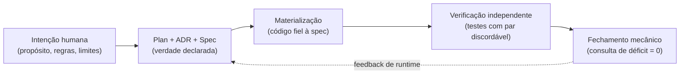
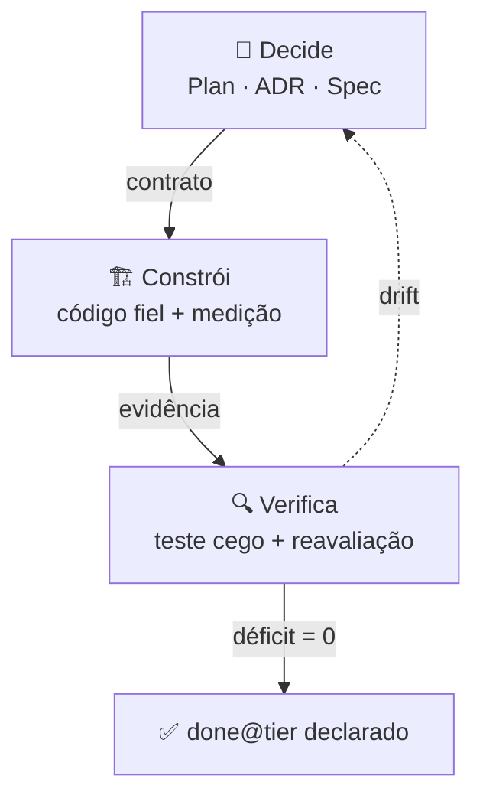

# 🧭 01 · Visão Geral da EEE

*Engenharia Empírica Evolutiva aplicada ao desenvolvimento de software com IA*

---

## 1. Definição

A **Engenharia Empírica Evolutiva (EEE)** é uma disciplina de engenharia de software para sistemas em que modelos de linguagem e agentes autônomos atuam como construtores de primeira classe. Três palavras a definem:

| Termo | O que impõe |
|---|---|
| **Engenharia** | Hierarquia explícita de verdade (`Plan → ADR → Spec → Code`), contratos declarados e fechamento mecânico. Nada é aceito por auto-relato. |
| **Empírica** | Toda afirmação de estado é medida na fonte, com par discordável e nível de evidência declarado. "Não exercitado" nunca vale como "passou". |
| **Evolutiva** | O sistema cresce por **arcos**: fatia fina → stubs e mocks → hardening → *shadow* → *enforce* → abstração só do que se repetiu. Nenhuma abstração nasce antes da segunda ocorrência. |

**EEEMIAD** é o nome desta publicação: a EEE formulada como *Metodologia de Inteligência Artificial para Desenvolvimento*. O método é a EEE; o sufixo nomeia o domínio de aplicação.

> [!NOTE]
> **Escopo deste repositório.** Aqui está a EEE em si: princípios, hierarquia da verdade, fases, regras, construção evolutiva, anti-padrões e guia prático. A instanciação em **dois agentes** (reflexivo e executivo), com briefs, reality-check de pré-voo e avaliação decisão por decisão, é tratada no repositório irmão [`EEEMIAD-dual`](../../README.md#-repositórios-irmãos--sibling-repositories).

## 2. O problema que a EEE resolve

Agentes de código impressionam na demonstração e colapsam em operação por uma razão que não é inteligência do modelo: **ausência de método**. Quatro falhas se repetem:

1. **Auto-graduação.** O mesmo agente escreve a spec, o código e o teste. Um erro de lógica gera um teste que o valida. O teste fica verde; a funcionalidade está errada.
2. **Resposta plausível.** O sistema devolve um valor bem-formado e tipado para uma pergunta que não foi feita. Por parecer resposta, atravessa revisão humana e testes rasos.
3. **Inversão de hierarquia.** O código diverge da documentação e, sob pressão, a documentação é ajustada para perdoar o atalho. As invariantes morrem em silêncio.
4. **"Pronto" pelado.** Tarefas são encerradas por auto-relato, sem qualificar o degrau de evidência alcançado.

## 3. Os dois caminhos

O documento canônico *A verdade, o materializador e o DONE* formaliza a bifurcação que todo ecossistema com IA enfrenta:

| Dimensão | Caminho 2 (convenção do mercado) | Caminho 1 (EEE) |
|---|---|---|
| **Premissa** | O LLM improvisa código a partir de prompts; o humano testa a improvisação para sempre. | O LLM materializa especificações formais em código, como um compilador materializa C em assembly. |
| **Papel do humano** | Depurador perpétuo de saídas estocásticas. | Validador da intenção, da governança e do valor. |
| **Fonte da verdade** | O código acumulado no repositório. | A hierarquia `Plan → ADR → Spec → Code`. |
| **Garantia** | Testes gerados pelo mesmo agente. | Separação de papéis, testes independentes, fechamento por reavaliação. |
| **Efeito sobre a atenção** | Colonização crescente. | Devolução real de horas (o sino de bambu). |

## 4. A tensão central: fidelidade × alavanca

Quanto mais verdade se empurra para a spec, mais fiel é a materialização, e **menos alavanca** a abordagem oferece: no extremo, o programa foi escrito duas vezes. Quanto mais abstrata a spec, maior a folga em que o modelo improvisa.

> [!IMPORTANT]
> O alvo honesto não é `spec = programa`. É: **a spec especifica o suficiente para que o resíduo de improvisação seja barato de verificar.** Esse ponto é escolhido por capacidade, não globalmente, e o degrau de DONE de cada capacidade **é** a sua posição nesse espectro.

Daí o programa de trabalho da EEE ser *bottom-up*: a cada arco, pergunta-se qual é o próximo predicado de comportamento que pode subir da improvisação para dentro da spec. Cada predicado erguido encolhe a improvisação e torna o teste funcional (a "muleta" de um materializador não confiável) menos necessário.

## 5. Os três papéis

A EEE separa três papéis. Podem ser ocupados por pessoas, por agentes distintos ou por combinações; o que não pode acontecer é **um só ator ocupar os três sobre o mesmo artefato**.

| Papel | Responsabilidade | Artefato típico |
|---|---|---|
| **Quem decide** | Explicita intenção, alternativas e consequências. | Plan, ADR, spec, charter de arco |
| **Quem constrói** | Materializa a spec; mede antes de editar; reporta com comando e saída. | Código, testes, reality-check |
| **Quem verifica** | Testa a spec sem ver a implementação; reexecuta a consulta que detectou o déficit. | Suíte independente, consulta de fechamento |

## 6. Mapa de leitura

| Capítulo | Pergunta que responde |
|---|---|
| [02 · Princípios](02-principios.md) | O que conta como "pronto" e o que nunca pode ser afirmado? |
| [03 · Hierarquia da Verdade](03-hierarquia-da-verdade.md) | Quem vence quando código e documento divergem? |
| [04 · Fases do Ciclo](04-fases-do-ciclo.md) | Em que ordem um subsistema amadurece? |
| [05 · Regras do Refinamento](05-regras-do-refinamento.md) | Como medir sem produzir respostas plausíveis? |
| [06 · Construção Evolutiva](06-construcao-evolutiva.md) | Como usar stubs, mocks, flags e arcos para crescer com segurança? |
| [07 · Anti-padrões](07-anti-padroes.md) | Quais armadilhas já foram medidas e nomeadas? |
| [08 · Guia de Aplicação](08-guia-de-aplicacao.md) | Por onde começar, em projeto novo ou legado? |
| [09 · Fundamentação](09-fundamentacao-academica.md) | Em que literatura a EEE se apoia? |
| [10 · Casos Ilustrativos](10-casos-ilustrativos.md) | Como as regras aparecem em incidentes reais? |
| [11 · Glossário](11-glossario.md) | O que significam arco, fatia, shadow, flag fantasma? |
