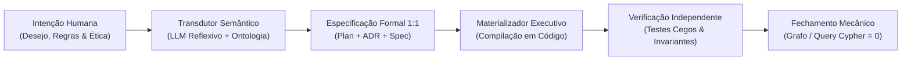
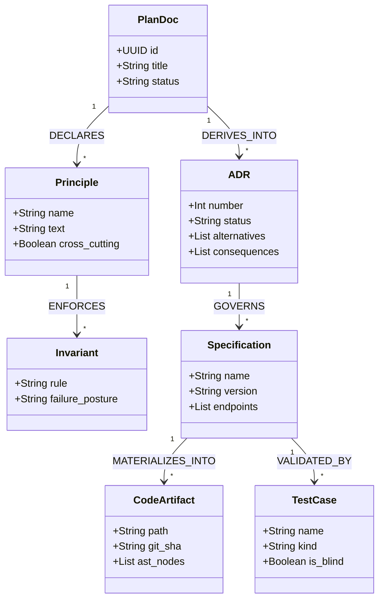

# 01. Visão Geral da Metodologia EEEMIAD
## Engenharia Empírica Evolutiva — Metodologia de IA para Desenvolvimento

---

### 1. Definição e Posicionamento
A **EEEMIAD** (**E**ngenharia **E**mpírica **E**volutiva — **M**etodologia de **I**nteligência **A**rtificial para **D**esenvolvimento) é uma estrutura metodológica formal projetada para governar o ciclo de vida de desenvolvimento de software onde modelos de linguagem de grande porte (LLMs) e agentes autônomos atuam como construtores de primeira classe.

Diferente de abordagens ad-hoc baseadas em "engenharia de prompt" ou ferramentas simples de IDE, a EEEMIAD trata o desenvolvimento assistido por IA como um **processo industrial de compilação semântica**.

---

### 2. Os Dois Caminhos do Desenvolvimento de Software com IA

No documento fundacional *A Verdade, o Materializador e o DONE*, formaliza-se a bifurcação que todo ecossistema moderno enfrenta:

| Dimensão | Caminho 2 (A Abordagem Convencional do Mercado) | Caminho 1 (A Doutrina EEEMIAD) |
|---|---|---|
| **Premissa Central** | O LLM improvisa código continuamente a partir de prompts vagos. | O LLM atua como compilador que materializa especificações formais em código. |
| **Papel do Humano** | Depurador perpétuo de saídas estocásticas e alucinações. | Validador de alto nível da intenção, governança e valor. |
| **Fonte da Verdade** | O código-fonte acumulado no repositório. | A hierarquia formal e unívoca: `Plan → ADR → Spec → Code`. |
| **Garantia de Acerto** | Heurística frágil e testes gerados pelo mesmo agente. | Separação estrita de papéis, testes adversariais cegos e verificação topológica. |
| **Impacto na Atenção** | Colonização crescente do tempo com revisões exaustivas. | Devolução real de horas humanas (o sino de bambu). |

---

### 3. A Estrutura Ontológica da Metodologia
A EEEMIAD apoia-se em um modelo relacional e ontológico estrito (implementado preferencialmente em Grafos de Propriedade como Neo4j):

---

### 4. Ciclo Operacional em Três Anéis
A metodologia organiza a engenharia em três anéis concêntricos de feedback:
1. **O Anel Reflexivo (Arquiteto / Cowork):** Conduz a exploração, analisa o impacto transversal, elabora propostas de ADR, define restrições e avalia o cumprimento de decisões.
2. **O Anel Executivo (Implementador / Code):** Opera com *Reality-Check pré-voo* obrigatório, inspeciona o código via AST (nunca busca textual cega), gera código estanque e emite relatórios com evidências mensuradas.
3. **O Anel Adversarial (Verificador / Gate):** Executa testes gerados a partir da especificação sem ver a implementação, reexecuta queries de auditoria e só concede fechamento por evidência direta.
