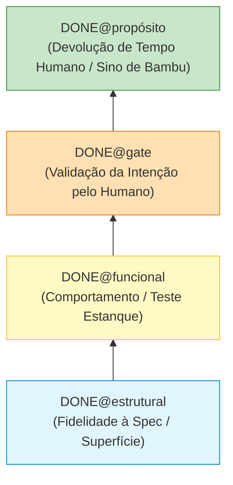

# 02. Princípios Fundamentais e a Pilha de DONE
## As Regras Inegociáveis da Engenharia Empírica Evolutiva

---

### 1. A Pilha Estratificada de DONE
Na EEEMIAD, **é expressamente proibido declarar uma tarefa como "pronta" (*DONE*) sem qualificador**. 
Um status "concluído" desprovido de seu nível convida o leitor a jusante a presumir que o sistema está correto no mundo real — a semente de todo débito técnico com agentes.

| Nível de DONE | O que afirma | Quem julga | Mensurável por Máquina? |
|---|---|---|:---:|
| **`DONE@estrutural`** | O código é uma imagem topologicamente fiel da especificação onde a especificação se manifesta (rotas, assinaturas, tipos, constraints). | Máquina (Extrator AST / Grafo) | **Sim** |
| **`DONE@funcional`** | O comportamento é correto onde a especificação foi silenciosa (lógica interna do corpo das funções). | Máquina (Testes unitários / integração estanques) | **Sim** |
| **`DONE@gate`** | A especificação é fiel à intenção humana e resolve a necessidade real. | Humano (Revisão deliberada) | **Não** |
| **`DONE@propósito`** | O sistema devolveu horas e atenção humana de qualidade (critério do manifesto). | Humano (Vida real) | **Não, por design** |

> [!IMPORTANT]
> **A Falha Geológica: Verificação $\ne$ Validação**
> - **Verificação** = *"Construímos o produto de forma correta?"* (Fidelidade do código à especificação). A máquina faz perfeitamente.
> - **Validação** = *"Construímos o produto certo?"* (Fidelidade da especificação ao propósito humano). Somente o humano pode julgar.
> `verified` **nunca pode vestir o crachá de** `validated`.

---

### 2. Os 8 Princípios Fundamentais da EEEMIAD

#### Princípio 1: O Sistema Não Pode Dizer "Pronto" Além da Evidência que Possui
A confiança nunca é presumida; ela é **conquistada e registrada**. Um motor de verdade honesto é, no limite, um **motor de evidência**: uma máquina que diz exatamente o que sabe e se recusa terminantemente a arredondar para "verdadeiro".

#### Princípio 2: Todo Critério Publica Sua Fidelidade e Limite
Todo teste ou validador deve declarar formalmente o que ele **garante** e o que ele **não garante**. 
O quadrante mais perigoso da engenharia de software é:
$$\text{Zona de Perigo} = \text{Alta Decidibilidade} \times \text{Baixa Fidelidade}$$
(Um teste com resultado verde nítido e instantâneo que testa uma propriedade cosmética ou mock forjado).

#### Princípio 3: Nada de Porcentagem no Subjetivo
Critério subjetivo é **julgamento atribuído** (um juiz humano nomeado + um procedimento formal de avaliação + carimbo de tempo imutável). 
Atribuir porcentagem a critérios qualitativos (ex.: "87% de usabilidade", "92% de elegância") é lavagem de subjetividade com verniz de falso rigor.

#### Princípio 4: Abstrair Somente o que se Repetiu ($\ge 2$ Vezes)
É expressamente proibido criar frameworks, middlewares genéricos, abstrações prematuras ou novas tabelas de banco para suportar cenários hipotéticos de primeiro uso. A abstração só é justificada quando o padrão de divergência ou repetição foi **observado e medido no mínimo duas vezes em fatias funcionais distintas**.

#### Princípio 5: Automatizar Somente o que Está Estável
Não se escrevem pipelines de CI/CD sofisticados, geradores autônomos ou rotinas de sincronização para fluxos de negócio ou contratos de dados que ainda sofrem alterações frequentes na Fase 3 (POC). Automatizar o instável gera manutenção desnecessária.

#### Princípio 6: Evolução Contínua Guiada por Feedback Real de Runtime
Nenhuma decisão de design resiste à prova de carga em produção. Quando os dados observados no cluster (*reality*) contradizem uma hipótese teórica registrada no *Plan*, a realidade prevalece: inicia-se o rito formal de revisão ascendente via ADR.

#### Princípio 7: Contratos Implícitos São Proibidos (§7 Explicit Contract Registry)
Toda interface de serviço deve manter um registro explícito cobrindo:
1. Invariantes de segurança (privilégio mínimo, segregação de tenants).
2. Trilha de auditoria (quem chamou, em nome de quem, sob qual autoridade).
3. Pré-condições e pós-condições.
4. Concorrência (locks de escrita, níveis de isolamento).
5. Modos de falha (Tabela M11).

#### Princípio 8: Doutrina do Fechamento por Re-avaliação (*Closure-by-Re-evaluation*)
Nenhuma tarefa ou issue pode ser fechada com base no auto-relato (*self-report*) do agente executor ("implementei as rotas solicitadas"). O encerramento exige a re-execução mecânica da verificação automatizada ou da consulta canônica no grafo que originalmente detectou a lacuna:
$$\text{Fechamento Legítimo} \iff \text{QueryDeDetecção}(\text{Sistema}) == 0$$
