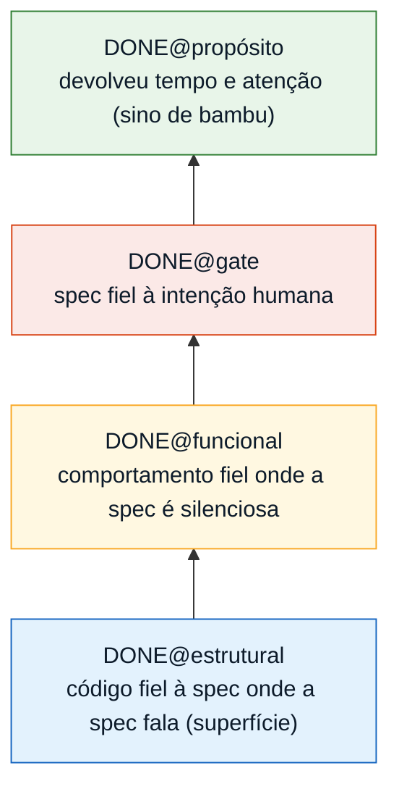

# 🏛️ 02 · Princípios e a Pilha de DONE

*As regras inegociáveis da Engenharia Empírica Evolutiva*

---

## 1. A pilha estratificada de DONE

Na EEE, **é proibido declarar uma tarefa "pronta" sem qualificador**. Um `closed` liso convida o leitor a jusante a completar "funciona": é a mentira cravada no mecanismo.

| Degrau | O que afirma | Quem julga | Mensurável pela máquina? |
|---|---|---|:---:|
| `DONE@estrutural` | O código é imagem topologicamente fiel da spec onde a spec se manifesta: rotas, assinaturas, tipos, constraints. | Máquina (extrator AST, grafo) | Sim (topológico) |
| `DONE@funcional` | O comportamento é fiel onde a spec é silenciosa: o corpo das funções. | Máquina (testes estanques) | Sim (exit code) |
| `DONE@gate` | A spec é fiel à intenção e resolve a necessidade real. | Humano (revisão deliberada) | Não |
| `DONE@propósito` | O sistema devolveu horas e atenção humana de qualidade. | Humano (vida real) | **Não, por desenho** |

> [!IMPORTANT]
> **Verificação ≠ Validação.**
> *Verificação* responde "construímos certo?" (código fiel à spec); a máquina faz.
> *Validação* responde "construímos a coisa certa?" (spec fiel à intenção); só o humano faz.
> `verified` **nunca veste o crachá de** `validated`. O ápice da pilha é imensurável pela máquina de propósito: a honestidade dos degraus de baixo existe para que o humano gaste julgamento só no topo.

### Por que o teste funcional é uma muleta

"Estrutural = correto" só vale se o materializador for confiável. Um compilador conquista essa confiança (determinístico, provado). Um LLM não: pode emitir uma superfície que casa com a spec e um corpo que faz outra coisa. O teste funcional é necessário **na exata medida em que a spec subdetermina o programa**. Conforme a spec ganha verdade (pré e pós-condições, tipos, cardinalidades), a muleta encolhe.

### Modo de verificação por garantia

Cada garantia carrega um **modo**, e o modo limita o degrau de DONE que ela alcança:

| Modo | O que é | Degrau máximo |
|---|---|---|
| **Determinístico** | Match exato; passou = tem a propriedade. | `DONE@funcional` nítido |
| **Limiar + confiança** | Gate estatístico com banda (p. ex. limite inferior de Wilson). Honesto só com a confiança declarada; nunca "100%". | `DONE@funcional` com banda |
| **Forma / juízo** | Fuzzy, atribuído a um juiz nomeado. | `DONE@gate` |

Granularidade é modo: **fatie até o pedaço ser determinístico; o resíduo que não reduz é o subjetivo irredutível**, e recebe juiz atribuído, nunca um número exato.

## 2. Os seis princípios do DONE

Cristalizados no documento canônico *A verdade, o materializador e o DONE*:

1. **DONE é estratificado e autodeclarante.** Sempre `done@tier`, nunca "done" pelado.
2. **Todo critério publica sua fidelidade, não só o veredito.** Um check diz o que passar nele garante **e o que não garante**. O quadrante perigoso é *alta decidibilidade com baixa fidelidade*: um verde nítido que não entrega.
3. **Nada de porcentagem no subjetivo.** Critério subjetivo é **julgamento atribuído** (juiz, procedimento e carimbo de tempo), não número. "87% de usabilidade" é lavagem de subjetividade com verniz de rigor.
4. **DONE escala com o risco.** A barra de evidência é função do custo de errar. Declare a aposta para a qual o critério foi calibrado: protótipo não é marca-passo.
5. **DONE é derrogável (*defeasible*).** Significa "nenhum defeito achado pela bateria B até o instante t", nunca "correto". Prova-se *não-done* (um teste falha); nunca se prova *done*. Testes de regressão são como uma aposta de DONE vira durável.
6. **Separar construção de validação.** "Construído certo" (fechamento) e "era a coisa certa" (gate) não trocam crachá.

## 3. Os cinco princípios da evolução

Os princípios que fazem a EEE **evolutiva**, extraídos da prática em arcos sucessivos:

7. **Abstrair somente o que se repetiu (≥ 2 vezes).** É proibido criar frameworks, middlewares genéricos ou tabelas transversais para cenários hipotéticos. A abstração só se justifica quando a mesma divergência ou repetição foi **observada em pelo menos duas fatias distintas** (Fase 6).
8. **Automatizar somente o que está estável.** Pipelines sofisticados e geradores autônomos não se escrevem para contratos que ainda mudam a cada fatia. Automatizar o instável multiplica manutenção.
9. **A realidade do runtime prevalece sobre a hipótese do plano.** Quando o observado contradiz o planejado, inicia-se o rito de **reconciliação ascendente** via ADR. Nunca se ajusta a spec para perdoar o código.
10. **Contratos implícitos são proibidos.** Toda interface mantém registro explícito de: invariantes de segurança, trilha de auditoria (quem chamou, em nome de quem, sob qual autoridade), pré e pós-condições, concorrência e **modos de falha** (matriz M11). Quem decide também descreve: toda tabela, flag ou job criado sob uma ADR entra na spec **no mesmo arco em que nasce**.
11. **Fechamento por reavaliação.** Nenhuma tarefa fecha por auto-relato. Fecha quando a verificação (consulta, teste, sonda) que **detectou o déficit** é reexecutada e retorna zero.

> [!TIP]
> **Uma frase para guardar:** *medir, não autopromover*. Disciplina EEE, "conquistar confiança em vez de presumi-la" e o sino de bambu são a mesma verdade em altitudes diferentes.

## 4. Vigias: o que pode apodrecer

- **Satisfação como carimbo.** "O humano decide" pode degenerar em gosto-como-veto. O ápice não é "o operador gostou?", e sim a pergunta específica: *devolveu tempo e atenção para o que importa?*
- **Atenção de construção confundida com regime permanente.** Construir a plataforma exige vigília; usá-la não pode exigir. O dia em que construir deixa de doer não é o dia em que usar deixa de doer; só o segundo cumpre o manifesto.
- **Retrofit de história bonita.** Casar tese técnica com o ethos é agradável, e por isso suspeito. Procurar ativamente a decisão de projeto que **contradiz** o manifesto, não só as confirmações.
