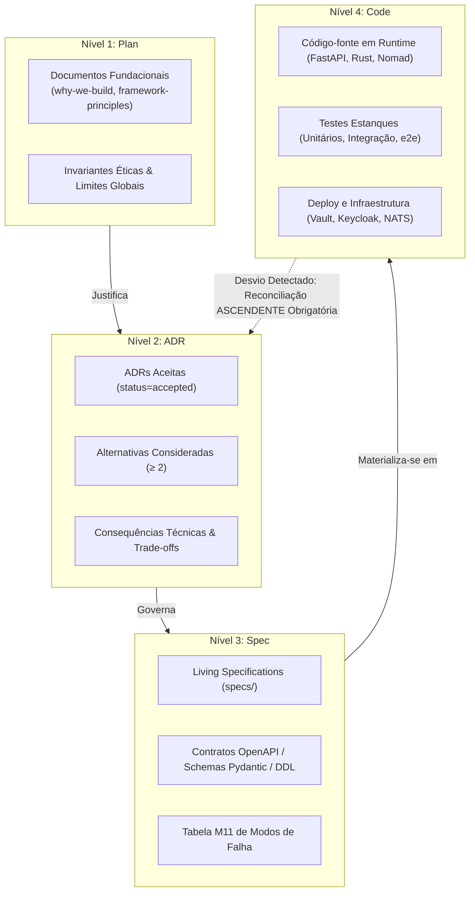

# 03. A Hierarquia Unívoca da Verdade
## A Cascata Canônica Plan → ADR → Spec → Code e a Reconciliação Ascendente

---

### 1. A Estrutura da Cascata
Na EEEMIAD, a integridade do sistema apoia-se em uma hierarquia unidirecional de autoridade documental:

$$\mathbf{Plan} \;\;(\text{Nível 1: Intenção \& Princípios}) \;\;\longrightarrow\;\; \mathbf{ADR} \;\;(\text{Nível 2: Decisões Arquiteturais}) \;\;\longrightarrow\;\; \mathbf{Spec} \;\;(\text{Nível 3: Contratos Formais}) \;\;\longrightarrow\;\; \mathbf{Code} \;\;(\text{Nível 4: Runtime \& Testes})$$

---

### 2. Definição Formal de Cada Camada

#### Camada 1: Plan (Intenção e Princípios)
- **O que reside aqui:** O propósito ético, os limites operacionais estritos (orçamentos de tokens, tempo de execução, modelo de isolamento de tenants) e a visão macro do produto.
- **Autoridade:** Não trata de implementação técnica; dita o que o sistema **pode e não pode fazer**.
- **Vida útil:** Anos. Só muda com alterações fundamentais na estratégia de produto.

#### Camada 2: ADR (Architecture Decision Records)
- **O que reside aqui:** As decisões arquiteturais que arbitram escolhas técnicas complexas.
- **Forma obrigatória:** Toda ADR possui número sequencial, status (`PROPOSED`, `ACCEPTED`, `DEPRECATED`, `SUPERSEDED`), contexto do problema, pelo menos duas alternativas analisadas com pró/contra explícitos, justificativa baseada em evidência empírica e lista de consequências assumidas.
- **Regra de ouro:** Nenhuma decisão arquitetural nasce aceita; toda minuta nasce `PROPOSED`.

#### Camada 3: Spec (Especificações Contratuais Formais)
- **O que reside aqui:** A verdade operacional da máquina. Schemas de entrada e saída (JSON Schema / Pydantic), endpoints HTTP, tipos de mensagens assíncronas (NATS), tabelas e constraints de banco de dados (DDL SQL).
- **Invariante:** Cada especificação é uma *Living Specification* que reflete 100% o que deve ser materializado. Especificações não contêm código-fonte ou hacks de implementação.

#### Camada 4: Code (Runtime e Implementação)
- **O que reside aqui:** O código executável nos microserviços, scripts de migração, configurações de container e suítes de testes.
- **Relação com a Spec:** O código é a **materialização fiel da especificação**, exatamente como o código binário/assembly gerado por um compilador é a materialização fiel de um código em C.

---

### 3. A Regra Inviolável de Arbitragem: Reconciliação Ascendente
Quando um teste, reality-check ou incidente em produção detecta uma discrepância entre o que o `Code` executa e o que a `Spec` prescreve:

> [!CAUTION]
> **O CÓDIGO NUNCA VENCE A DIVERGÊNCIA POR JÁ ESTAR NO AR.**
> Resolver o conflito simplesmente ajustando o texto da `Spec` para se conformar ao atalho do `Code` constitui a mais grave violação metodológica: a **Inversão de Hierarquia (Anti-padrão §6.7 / 10.7)**.

#### O Fluxo de Reconciliação Correto:
1. **Identificação e Isolamento:** O Agente Executivo ou o teste aponta o drift entre código e especificação.
2. **Subida para a Camada Superior:**
   - Se o desvio do código foi um pragmatismo deliberado da Fase 3 que se provou seguro e indispensável em runtime, **ele não pode ser aprovado silenciosamente**.
   - Redige-se uma **ADR Formal de Emenda** justificando tecnicamente por que o comportamento do código é superior ao da especificação original.
3. **Ratificação Humana:** A ADR é aprovada pelo operador/arquiteto (`status=accepted`).
4. **Atualização da Especificação:** A `Spec` é formalmente atualizada para incorporar o novo contrato.
5. **Harmonização do Código:** Os testes e o código são homologados contra a nova especificação.

---

### 4. Exemplos Reais de Prevenção de Inversão de Hierarquia

| Cenário de Divergência | Resolução Errada (Inversão de Hierarquia) | Resolução Correta (EEEMIAD) |
|---|---|---|
| **Caso 1: Autenticação de Hop Interno** (Sun recebia tarefas sem validação de token interno). | Alterar a spec para dizer que a rota `/v1/tasks` é pública e aberta. | Emitir a **ADR-042**, criar o token de serviço `SUN_SERVICE_TOKEN`, fechar a rota e atualizar a spec para exigir Bearer obrigatório. |
| **Caso 2: Token de Admin Global** (`SATURN_ADMIN_TOKEN_FALLBACK` permitia bypass de todo o RBAC). | Documentar o token mestre como funcionalidade na spec de segurança. | Emitir a **ADR-031**, eliminar o token mestre do código e impor que toda administração passe pelo OpenFGA. |
| **Caso 3: Timeout de Latência do Themis** (Spec dizia 75 ms; Nomad operava com 500 ms). | Alterar o arquivo `.nomad` para 75 ms às cegas (quebrando produção) ou ignorar o número. | Medir a latência real em carga, emitir emenda à **ADR-011** documentando a razão empírica dos 500 ms e atualizar a spec. |
