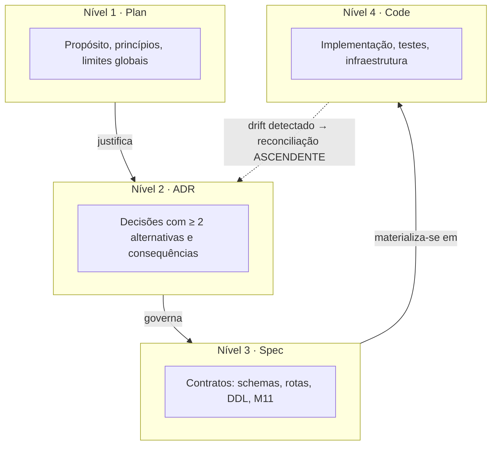

# 🔺 03 · A Hierarquia Unívoca da Verdade

*A cascata Plan → ADR → Spec → Code e a reconciliação ascendente*

---

## 1. A estrutura da cascata

A integridade de um sistema sob EEE apoia-se em uma hierarquia unidirecional de autoridade documental:

```
Plan  (nível 1 · intenção e princípios)
  └─► ADR  (nível 2 · decisões arquiteturais)
        └─► Spec  (nível 3 · contratos formais)
              └─► Code  (nível 4 · runtime e testes)
```



## 2. Definição de cada camada

### Nível 1 · Plan (intenção e princípios)
- **Contém:** o propósito, os limites operacionais (orçamentos, isolamento, posturas de falha padrão) e a visão do produto.
- **Autoridade:** dita o que o sistema **pode e não pode** fazer; não trata de implementação.
- **Vida útil:** anos. Muda só com alteração fundamental de estratégia.

### Nível 2 · ADR (registros de decisão arquitetural)
- **Contém:** as decisões que arbitram escolhas técnicas.
- **Forma obrigatória:** número sequencial; status (`PROPOSED`, `ACCEPTED`, `DEPRECATED`, `SUPERSEDED`); contexto com origem empírica; **pelo menos duas alternativas** com prós e contras; consequências assumidas; decisões numeradas (D1, D2, ...).
- **Regra de ouro:** nenhuma decisão nasce aceita. **Quem propõe não ratifica**: a ratificação é artefato separado, que cita evidência, SHA e nível de prova.

### Nível 3 · Spec (contratos formais vivos)
- **Contém:** a verdade operacional da máquina: schemas de entrada e saída, rotas, mensagens assíncronas, DDL, invariantes e a matriz de modos de falha (M11).
- **Invariante:** a spec é uma *living specification* em paridade com o que deve ser materializado. Não contém código nem hacks. **Critério de saída que cita um limite operacional aponta para onde o limite vive; não o copia** (um literal numérico copiado diverge no deploy seguinte, e a divergência se resolve em silêncio a favor do código).

### Nível 4 · Code (runtime e implementação)
- **Contém:** código executável, migrações, manifestos de deploy, suítes de teste.
- **Relação com a spec:** o código é a **materialização fiel** da spec, como o binário é a materialização fiel do fonte.

## 3. A regra inviolável: reconciliação ascendente

Quando um teste, um reality-check ou um incidente detecta discrepância entre o que o código faz e o que a spec prescreve:

> [!CAUTION]
> **O código nunca vence a divergência por já estar no ar.**
> Ajustar o texto da spec para se conformar ao atalho do código é a violação mais grave da metodologia: a **inversão de hierarquia**. Corolário: **não se reconstrói ADR a partir do código**. O código é evidência do que foi feito, nunca do que foi decidido.

### O fluxo correto

1. **Identificar e isolar** o drift, com a camada em que foi medido declarada.
2. **Subir para a camada superior.** Se o desvio do código foi um pragmatismo da Fase 3 que se provou indispensável em runtime, ele **não é aprovado em silêncio**: redige-se uma **emenda de ADR** (`status=PROPOSED`) justificando por que o comportamento observado é superior ao contrato original.
3. **Ratificar** em artefato separado, por quem decide (humano ou papel decisor), com a evidência de runtime citada.
4. **Atualizar a spec** para incorporar o novo contrato.
5. **Homologar código e testes** contra a spec nova.
6. **Varrer as dependentes.** Corrigir uma premissa exige varrer todas as decisões que se apoiavam nela (Regra R9).

### Em conflito entre camadas

| Conflito | Quem vence |
|---|---|
| Spec ↔ Código | Spec |
| ADR ↔ Spec | ADR |
| Texto original da ADR ↔ emenda ratificada | Emenda |
| Qualquer camada ↔ Plan | Plan |

Toda reconciliação declara a **camada autoritativa** contra a qual confirmou, e confirma contra a **mais alta** que fala do assunto, não contra um degrau acima do código.

## 4. Exemplos ilustrativos (genéricos)

| Divergência observada | Resolução errada (inversão) | Resolução EEE |
|---|---|---|
| Um salto interno entre dois serviços aceita tarefas sem validar credencial; a spec exige token. | Reescrever a spec dizendo que a rota interna é "confiável por rede". | Emitir ADR de emenda; introduzir credencial de serviço; fechar a rota; atualizar a spec exigindo `Bearer`. |
| Um token administrativo global permite contornar toda a autorização; "facilita a operação". | Documentar o token mestre como funcionalidade. | ADR eliminando o token; toda administração passa pela política de autorização; migração com janela de rollback. |
| A spec diz *timeout* de 75 ms; o deploy opera a 500 ms há meses sem incidentes. | Alterar o deploy para 75 ms às cegas, ou ignorar o número. | Medir a latência real sob carga; emendar a ADR com a razão empírica; fazer a spec **apontar para a fonte** do limite em vez de copiá-lo. |
| Cinco tabelas existem em produção e nenhuma aparece na spec de banco. | Considerar "detalhe de implementação". | Quem decide também descreve: cada tabela entra na spec no mesmo arco; Fase 8 varre a paridade. |
