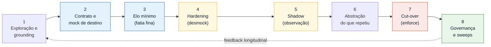

# 🔄 04 · As Oito Fases do Ciclo

*Da intenção inicial à governança evolutiva*

---

## 1. Visão geral

A EEE divide o amadurecimento de qualquer subsistema, contrato ou funcionalidade em **oito fases progressivas**. Elas não são um processo em cascata: um sistema maduro tem subsistemas em fases diferentes ao mesmo tempo, e cada **arco** (ver [06 · Construção Evolutiva](06-construcao-evolutiva.md)) percorre um trecho delas.

## 2. As fases

### Fase 1 · Exploração e grounding
- **Objetivo:** confrontar a intenção com o terreno real; produzir o mapa sistêmico ponta a ponta.
- **Atividades:** sondas de rede e de API, inspeção de bibliotecas, inventário de superfícies existentes.
- **Disciplina:** nada vai para a árvore de produção. Rascunhos vivem em `scratch/` ou em branches de *spike*. Toda afirmação de estado sai com o **nível de ground truth** declarado (Regra R15).

### Fase 2 · Contrato e mock de destino
- **Objetivo:** fixar as interfaces antes de qualquer lógica de negócio, e definir **o contrato que o mock e a implementação real terão de satisfazer**.
- **Atividades:** schemas de entrada e saída, DDL com constraints, rascunho da ADR governante (`PROPOSED`), primeira versão da matriz M11.
- **Critério de saída:** o mock devolve **formas verdadeiras**, reproduzíveis pela implementação real quando ela entrar atrás. Um mock que devolve formas que o real não produzirá é dívida disfarçada.

### Fase 3 · Elo mínimo (fatia fina vertical)
- **Objetivo:** provar o acoplamento ponta a ponta com o mínimo de código.
- **Atividades:** uma fatia que liga entrada, processamento e saída, atravessando todas as camadas uma vez.
- **Disciplina:** pragmatismos locais (stubs em memória, `DRY_RUN=1`) são permitidos **desde que marcados como tais** no código e nos dados que produzem. **O mock valida o cano, não a medida**: prova que o fluxo atravessa; não prova que o valor está certo.

### Fase 4 · Hardening (desmock)
- **Objetivo:** substituir cada stub pela implementação real, um de cada vez, e endurecer segurança e resiliência.
- **Atividades:** troca de defaults de desenvolvimento por configuração e segredos da fonte oficial; autenticação nos saltos internos; tratamento de exceções; **tabelamento dos modos de falha** (M11) e injeção de falha para provar a postura de cada gate.
- **Critério de saída:** nenhum caminho de produção depende de literal de desenvolvimento; cada stub remanescente está atrás de flag com default desligado e gatilho de aposentadoria verificável.

### Fase 5 · Shadow (observação não bloqueante)
- **Objetivo:** medir o comportamento novo sob carga real **sem** que ele decida.
- **Atividades:** o componente opera em `shadow`: consome payloads reais, calcula a decisão e grava a divergência contra o comportamento vigente em um *intent-log* auditável.
- **Janela:** declarada no charter do arco em **oportunidades reais** (Regra R5), não em tempo de calendário apenas. "Zero divergências em amostra insuficiente" é resultado inconclusivo, não evidência (R6).
- **Limite do shadow:** ele valida *o que a lógica nova computa*; o primeiro *enforce* valida *o que escrever ao reconciliar o estado*. Orce uma surpresa de reconciliação.

### Fase 6 · Abstração do que se repetiu
- **Objetivo:** nomear o padrão depois que ele apareceu duas vezes.
- **Regra:** só após observar o mesmo comportamento ou a mesma divergência em **duas ou mais fatias distintas** autoriza-se extrair biblioteca, modelo genérico ou tabela transversal. Casos especiais empilhados sem consolidação são dívida da Fase 6; abstração antes da segunda ocorrência é especulação.

### Fase 7 · Cut-over controlado (enforce)
- **Objetivo:** virar a chave de `shadow` para `enforce`.
- **Rito obrigatório (pré-voo):**
  1. **Raio de explosão** enumerado: o que muda além do alvo declarado (credenciais, estado de cluster, dados destrutivos).
  2. **Reversível?** Se não, parar: exige decisão explícita por ação.
  3. **Rollback ensaiado** antes da virada, com tempo de recuperação medido.
  4. **Precondição de estado** verificada na fonte: tuplas, grants, chaves e tabelas existem **antes** do deploy (comando e resultado observado).
  5. **Composição de flips:** quais outros gates mudaram nesta janela e o **produto** deles foi exercitado ponta a ponta (comando e resultado, não inferência).
  6. **Mecanismo existe:** o caminho `enforce` está construído e verificado sintaticamente; nomear a fase na ADR não a constrói (R26).
- **Após o flip:** janela de observação declarada antes de **aposentar** a flag.

### Fase 8 · Governança evolutiva e sprint-exit sweeps
- **Objetivo:** impedir a regeneração do *spec-rot* e manter a entropia baixa.
- **Rito de saída de sprint:**
  - Varredura via AST por código morto, rotas órfãs e **flags fantasma** (declaradas, zero consumidores).
  - Confronto bidirecional 1:1 entre rotas expostas e rotas especificadas.
  - **Custódia do registro de decisão:** toda ADR citada existe no ramo principal; âncoras `arquivo:linha` resolvem para o símbolo nomeado ao lado (R13, R14).
  - Envelhecimento: decisões em `PROPOSED` além do prazo declarado são promovidas, emendadas ou canceladas.
  - **Proof test** dos mecanismos de contingência: tratadores cuja única manifestação orgânica é a falha que tratam são exercitados deliberadamente, em cadência declarada.
  - Reexecução da bateria de fechamento por reavaliação.

## 3. Como as fases se encaixam em um arco

| Trecho do arco | Fases percorridas | Flag |
|---|---|---|
| Charter e contrato | 1 → 2 | não existe ainda |
| Fatia fina com stubs | 3 | `OFF` (comportamento neutro) |
| Desmock e M11 | 4 | `OFF` → `SHADOW` |
| Observação | 5 | `SHADOW` |
| Virada | 7 | `ENFORCE` |
| Aposentadoria da flag e sweep | 8 (e 6, se repetiu) | removida |
