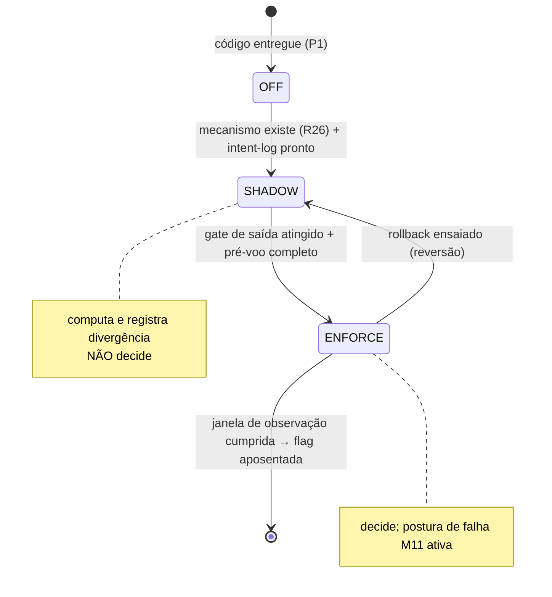

# 🏗️ 06 · Construção Evolutiva: Stubs, Mocks, Flags e Arcos

*Como a EEE constrói: do cano vazio ao enforce, sem nunca confundir andaime com edifício*

---

## 1. A unidade de evolução é o arco

Um **arco** é o trecho de trabalho que leva **uma propriedade** do sistema de "não existe" a "existe, está ligada e foi medida", percorrendo as fases da EEE sob uma flag. Um arco **abre com um charter** e **fecha com um gate mensurável e uma evidência**, nunca por declaração.

```mermaid
flowchart LR
    CH["📜 Charter<br/>propriedade +<br/>condição de refutação"] --> RC["🔎 Reality-check<br/>o terreno é o que<br/>o charter assume?"]
    RC --> P1["P1 · Fatia fina<br/>flag OFF<br/>comportamento neutro"]
    P1 --> P2["P2 · Shadow<br/>intent-log +<br/>detecção de divergência"]
    P2 --> P3["P3 · Hardening<br/>desmock + M11 +<br/>testes de falha"]
    P3 --> P4["P4 · Cut-over<br/>pré-voo +<br/>flag ENFORCE"]
    P4 --> OBS["⏱️ Observação<br/>janela declarada"]
    OBS --> RET["🧹 Aposentadoria<br/>da flag + sweep"]
    style CH fill:#e3f2fd,stroke:#1565c0,color:#0d1b2a
    style P4 fill:#fbe9e7,stroke:#d84315,color:#0d1b2a
    style RET fill:#e8f5e9,stroke:#2e7d32,color:#0d1b2a
```



### O charter

O charter é o contrato do arco. Especifica **propriedade**, não mecanismo (R11):

```markdown
## Charter · <nome do arco>
- Propriedade alvo: "nenhuma leitura de recurso de tenant é servida sem credencial válida"
- Condição de refutação: "uma requisição sem bearer que receba 200 refuta o arco"
- Flag: RESOURCE_READ_AUTH_MODE ∈ {off, shadow, enforce} · default no código: off
- Postura de falha (M11): dependência de autorização indisponível → 503 (fail-closed, loud)
- Gate de saída: 0 refutações em ≥ N oportunidades reais em shadow; repro ao vivo nível 4
- Janela de observação pós-enforce antes de aposentar a flag: <declarada>
```

Sem condição de refutação, não há arco: há intenção.

## 2. Stubs e mocks: o andaime que se declara andaime

A EEE usa stubs e mocks agressivamente na Fase 3, sob uma regra única:

> [!IMPORTANT]
> **O mock valida o cano, não a medida.** Um stub prova que o fluxo atravessa todas as camadas (entrada → processamento → saída). Ele **não** prova que o valor está certo. Toda saída de andaime que possa ser lida como medição é uma resposta plausível em formação.

### Distinções que importam

| Artefato | O que faz | O que prova | Risco típico |
|---|---|---|---|
| **Stub** | Devolve resposta fixa ou mínima | O cano existe e o contrato de forma é satisfazível | Virar caminho de produção por omissão |
| **Mock** | Registra chamadas e permite asserir interações | O chamador fala com o colaborador como a spec prescreve | Testar a implementação, não o contrato |
| **Fake** | Implementação simplificada mas funcional (em memória) | Comportamento de borda sem infraestrutura | Divergir silenciosamente do real |
| **Dry-run** | Executa o caminho real sem efeitos | A lógica de decisão, sem escrita | Confundir "o que computaria" com "o que escreveria" |

### As cinco regras do andaime

1. **Formas verdadeiras.** O mock devolve formas que a implementação real **produzirá**; o contrato (Fase 2) é escrito para os dois. Mock que inventa forma própria é dívida.
2. **Marcação na fonte e no dado.** Todo caminho de stub é identificável sintaticamente (nome, módulo ou decorador) e todo dado produzido por ele carrega proveniência (`unknown` ou `scaffold`, nunca `real`). Um score constante gravado por andaime e lido como medição é a instância clássica da família.
3. **Atrás de flag, default desligado, valor explícito, log alto.** Um stub que sobrevive à Fase 3 vive atrás de uma flag cujo default no código é `off`, com o valor **explícito** no deploy e uma linha de log no boot quando ligado. Fallback silencioso para stub é fail-open disfarçado.
4. **Raio histórico medido.** Antes de desmockar, medir **quantos dados de produção vieram do stub** (por sentinela, por proveniência). O número entra no fechamento do arco.
5. **Gatilho de aposentadoria verificável.** O stub só é removido quando um comando mecânico prova que nada o consome: `grep -rl STUB_FLAG tests/` vazio, zero referências no AST. Até lá, ele existe e está documentado na spec (R30).

### Desmock: um colaborador por vez

Desmockar é substituir um stub pela implementação real **sem mudar o contrato**. A ordem segue a dependência e a alavanca:

1. Configuração e segredos (tirar defaults de desenvolvimento do caminho de produção).
2. Identidade e tenant **pela borda** (nunca do payload).
3. Colaboradores externos (modelo, banco, barramento).
4. Sinks de observabilidade e auditoria.
5. Remoção dos caminhos de mock.
6. Flip do `DRY_RUN` para execução real, **gated** pelo operador.

Cada passo é uma fatia com teste próprio e com o **mesmo** contrato de forma do mock. Se o real não satisfaz o contrato que o mock satisfazia, o defeito está no contrato ou no real, nunca "no teste".

## 3. Flags: o mecanismo de evolução controlada

Uma flag é a **âncora operacional** de um arco. Ela não é um booleano de conveniência; é um contrato com cinco atributos obrigatórios.

| Atributo | Regra |
|---|---|
| **Default no código** | Sempre o comportamento **neutro** (`off`). O código novo é entregue sem mudar o produto. |
| **Valor no deploy** | Sempre **explícito** no manifesto versionado, mesmo quando igual ao default. "Ausente → default" é estado fora da fonte. |
| **Domínio** | `off \| shadow \| enforce` (ou `OFF \| ON` para flags sem fase de observação). Um booleano onde há três estados é a assinatura da família (R1). |
| **Postura de falha** | Declarada na matriz M11: o que acontece quando a dependência cai, por estado da flag. |
| **Registro** | Toda flag aparece no **ledger de enforcement**: default, valor, estado, garantia, postura, ADR. Flip e ledger mudam **no mesmo commit**. |

### Estados e o que cada um garante



### Patologias de flag (todas medidas)

- **Flag fantasma:** declarada na configuração, **zero consumidores** no código. Dá a sensação de controle sem controlar nada. Detectável por AST na Fase 8.
- **Caminho `enforce` inexistente:** a ADR nomeia a fase; o código só emite *warning*. Flipar não muda nada além da verbosidade (R26).
- **Estado fora da fonte:** flag virada à mão no runtime; um redeploy reverte em silêncio. *Se governa comportamento, vive na fonte.*
- **Tri-estado colapsado:** dependência indisponível devolvendo `401` em vez de `503`. O cliente lê "credencial inválida" quando a verdade é "não consegui verificar".
- **Composição não exercitada:** três flips corretos na mesma janela, cada um com pré-voo próprio, **nenhum com pré-voo do produto**. O segundo quebra o caminho pelo qual o terceiro pergunta.
- **Shadow que mede o delta errado:** shadow computa *nova lógica − lógica antiga*; o primeiro *enforce* reconcilia *lógica nova − estado real*. São deltas diferentes; o segundo traz surpresas que o primeiro estruturalmente não vê.

### Flags em greenfield (sem comportamento vigente)

O `shadow` mede *computado × vigente*. Num sistema novo não há vigente, e um `shadow` sem par é teatro. Três decisões tornam o contrato de flag aplicável mesmo assim:

| Decisão | Regra |
|---|---|
| **Tipo da flag** | **De superfície** governa uma rota ou recurso: `off` responde `404` e a interface não o exibe (entregue, desligado). **De regra** governa uma verificação dentro de um caminho que já existe: `off` não avalia, `shadow` avalia e registra sem bloquear, `enforce` bloqueia. O charter declara o tipo. |
| **Oráculo nomeado** | `shadow` só existe com um oráculo independente, nomeado no charter: implementação em outra linguagem, consulta escrita à mão, invariante verificável (unicidade, contagem) ou fixture com valor esperado. O oráculo tem o próprio controle negativo: adulterado, ele **precisa** divergir. |
| **Sem oráculo em tempo de execução** | A flag é declarada **bi-estado** `off \| enforce`, no charter e no ledger. A propriedade é provada pela bateria (1)(2)(3), por oráculo offline e por injeção de falha. Declarado, isso é legítimo; implícito, é um tri-estado colapsado (R1). |

Entre o charter e a P1, toda flag declarada ainda não tem consumidor. O sweep da Fase 8 lê o ledger: flag sem consumidor **e** sem evidência de arco é "aguardando o arco"; flag sem consumidor com o arco fechado é fantasma.

## 4. Integração por testes ao longo do arco

Os testes de um arco não são uma fase; são a **trilha de evidência** que acompanha cada passo.

### O par discordável em toda bateria (R2)

```
(1) o caso alvo, antes barrado        → passa    (a mudança funcionou)
(2) quem já passava                   → passa    (não quebrou o legado)
(3) o VIZINHO que deve seguir barrado → BARRA    (o afrouxamento não vazou)
```

Sem (3), um afrouxamento acidental produz exatamente o mesmo verde. A regra vale com força redobrada em mudanças que **alargam** validação: é a direção em que o instinto de gate não protege, porque tudo passa a passar.

### Teste primeiro, e o vermelho antes do verde

O teste do caso alvo é escrito **antes** do código e deve **falhar** pela razão certa. Um teste que nasce verde não mediu nada: *probe-and-revert* (injetar o defeito exato, confirmar o vermelho, reverter) é obrigatório antes de aceitar o verde.

**Defesa em profundidade.** Quando duas camadas garantem a mesma propriedade (uma validação na aplicação e uma restrição no banco, por exemplo), remover uma deixa o teste verde: a outra recusa sozinha, e o probe não mediu nada. Então: (a) o probe **declara as camadas que remove**; (b) cada camada redundante ganha **um teste que a exercita sozinha** (o que insere direto no banco prova a restrição; o que chama a função prova a regra da aplicação); (c) um probe que remove todas as camadas confirma que a bateria inteira vê a propriedade.

### Cada bateria declara o estado de que parte

Uma bateria que depende de estado (banco, fila, arquivos) declara **de que estado parte** e o **prepara ela mesma**: banco isolado por suíte, ou carga da fixture no próprio arquivo. Baterias que compartilham estado sem declarar se sabotam: uma suíte que trunca o banco apaga a fixture de que a outra depende, e a falha aponta para o código errado. Antes de ler uma série de falhas, nomeie o processo gerador (R4): a primeira pergunta é "de que estado este teste partiu?".

### Dívida declarada como teste (R29b)

Quando uma propriedade ainda não vale (por exemplo, "a mutação de política exige credencial" em P1), ela entra na bateria como asserção negativa marcada `xfail(strict=True)`. O teste documenta a dívida **e** anuncia a quitação: ao implementar a propriedade, ele passa a `XPASS` e falha a suíte, obrigando a promovê-lo a teste normal. Em arcos onde instrumentos mentiram, foi o único mecanismo que anunciou boa notícia que ninguém pediu.

### Injeção de falha para cada linha da M11

Para cada gate, a bateria prova a postura declarada sob falha da dependência: indisponível, timeout, `5xx`, corpo inválido, configuração vazia. Em um gate de decisão, **todas** devem negar (fail-closed) e logar alto; em um sumidouro de evidência, **nenhuma** pode descartar o registro (fail-open com buffer durável, R7). Numa **entrega com evidência obrigatória** (um artefato cuja emissão precisa ficar registrada), a evidência precede a entrega: falha ao registrar → nada é entregue; falha ao produzir depois de registrar → erro, com o registro mantido e anotado ([M11](../../templates/pt/failure-modes-m11-template.md), doutrina 5). O caminho feliz permanece verde ao lado, como controle.

### Independência no degrau funcional

Quando o mesmo autor (humano ou modelo) escreve spec, código e teste, casos **consistentemente errados** passam na verificação e ficam invisíveis dentro do "verificado". Em um laço experimental com autoria única, a taxa de "verificado por execução" ficou em torno de 0,51 (IC 95% 0,41–0,62) e subiu para cerca de 0,62 (IC 95% 0,53–0,71) ao fixar tipos na spec; e esse número é um **limite superior** da correção real, inflado por casos autoconsistentes e errados de tamanho desconhecido. Só autoria independente ou cega enxerga esse teto. Por isso o papel **quem verifica** gera testes a partir da spec e da M11, sem ler a implementação, e o oráculo de um arco vem de um autor diferente de quem implementa (outra pessoa, outro modelo ou outra linguagem; ver [08 §6](08-guia-de-aplicacao.md#6-divisão-de-tarefas-por-nível-de-contexto-opcional)).

### Nível de prova no fechamento (R15)

O fechamento do arco declara em que nível cada afirmação foi provada. Um ledger inteiro no nível 1 (arquivo versionado) com deploys reais provados no nível 4 (reprodução ao vivo) é honesto; um ledger que não declara nível é lido como 4 e costuma ser 1. Antes do nível 4, exercite o **artefato de deploy** (nível 3b): uma suíte verde no processo de teste (3a) não vê o que o empacotamento deixou de fora. No nível 4, declare **leitura** ou **escrita**: a suíte que roda contra produção deve ter uma chave que desliga os casos que escrevem, e um nível 4 em leitura não prova a propriedade de escrita.

## 5. A ampliação evolutiva

O arco não termina no `enforce`. Termina quando a flag foi **aposentada** após a janela declarada, a spec descreve o que existe (R30), e o sweep da Fase 8 não encontra fantasmas. A partir daí, três movimentos sustentam o crescimento:

1. **Erguer um predicado por arco.** Cada arco escolhe o próximo predicado de comportamento que sobe da improvisação para a spec (um tipo fixado, uma pós-condição, uma cardinalidade). A muleta funcional encolhe um degrau.
2. **Abstrair na segunda ocorrência.** Quando o mesmo padrão de gate, de flag ou de reconciliação aparece em duas fatias, nomeia-se e extrai-se (Fase 6). Antes disso, repetir é mais barato que errar a abstração.
3. **Automatizar o que parou de mudar.** Sweeps, ledgers e consultas de fechamento tornam-se scripts quando o contrato que verificam estabilizou. Automatizar o instável multiplica manutenção.

> [!TIP]
> **Regra de bolso para orçar um arco:** o número de idas e voltas sem código escala com o **raio de explosão**. Leitura e scratch reversível: vai, erra barato. Irreversível, produção, credencial: certeza integral antes de tocar. "Melhor dez idas sem código do que uma ida com código e dez voltas de correção." Não confundir com paralisia em coisa reversível.

## 6. Exemplo executável

O diretório [`examples/evolutionary-arc/`](../../examples/evolutionary-arc/README.md) contém um arco completo em Python puro: um **sumidouro de auditoria** que nasce como stub atrás de `AUDIT_SINK_MODE=off`, passa por `shadow` (computa e registra divergência sem decidir) e chega a `enforce` com postura M11 de fail-open com buffer durável. A bateria exibe o par discordável, a dívida em `xfail(strict)`, a injeção de falha e o controle contra arrasto. Sem dependências externas.
