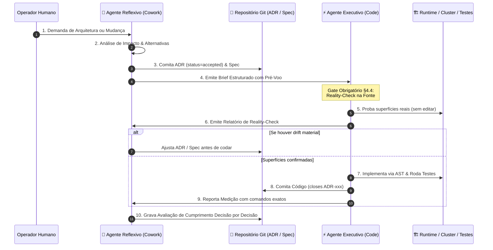

# 06. O Fluxo de Trabalho de Dois Agentes (Dual-Agent Workflow)
## Divisão Estrutural de Papéis: Modo Reflexivo versus Modo Executivo

---

### 1. A Premissa da Especialização de Papéis
O mesmo modelo de inteligência artificial de fronteira (ex.: Claude 3.5 Sonnet, Gemini 1.5 Pro, GPT-4o) exibe posturas operacionais radicalmente diferentes dependendo de como sua sessão é instanciada e guiada:
- **Modo Reflexivo:** Sessões longas, orientadas a planejamento, com visão transversal do histórico, incentivo a críticas construtivas e ponderação de trade-offs arquiteturais.
- **Modo Executivo:** Sessões focadas em código, comandos de terminal, diffs cirúrgicos, geração de testes e ferramentas de refatoração.

Em vez de forçar um único agente a ser "médio em tudo", a EEEMIAD institucionaliza a **divisão estrutural em dois papéis independentes com handoff explícito**:



---

### 2. A Matriz de Responsabilidades

| Dimensão | 🧠 Agente Reflexivo (Cowork) | ⚡ Agente Executivo (Code) |
|---|---|---|
| **Foco Principal** | Decisões arquiteturais, ADRs, especificações formais, estratégia de produto e avaliação crítica. | Implementação estrita de specs aprovadas, testes unitários e de integração, refatoração e migrações. |
| **Atitude Operacional** | Cética, adversarial, reflexão antes da ação, explicitação de riscos e consequências. | Cirúrgica, disciplinada, guiada por ferramentas, estritamente orientada a evidências de código. |
| **Permissão de Escrita** | Escreve apenas em `Plan/`, `reality/`, `achados/` e minutas de ADR. **Nunca edita código em produção.** | Edita código-fonte, scripts de build, infraestrutura e testes. |
| **Primeiro Artefato de Toda Sessão** | Mapeamento de premissas e identificação de invariantes afetadas. | **Reality-Check pré-voo (§4.4)** contra o código e runtime reais. |

---

### 3. O Gate Mandatório do Reality-Check (§4.4)
Uma sessão de execução **não começa editando arquivos**. O primeiro passo obrigatório do Agente Executivo é provar que as âncoras citadas no brief realmente existem no código vivo:
- Nomes de funções, números de linhas, schemas de tabelas e variáveis de ambiente citadas pelo planejador são tratadas como **"hipóteses a verificar, nunca como fatos consumados"**.
- Se o Agente Executivo detectar que um commit intermediário removeu uma função ou alterou um schema, a implementação é **imediatamente interrompida**: emite-se um *Drift Report* para o Agente Reflexivo.

---

### 4. O Bloco de Pré-Voo e Raio de Explosão (§5.4)
Todo brief de implementação que envolva alterações de infraestrutura, bancos de dados, tokens ou migrações deve conter no topo o seguinte bloco padronizado:

```markdown
### Raio de Explosão (Pré-Voo Obrigatório):
1. Efeitos Colaterais: O que muda além do alvo declarado? (Chaves, credenciais, clusters, schemas).
2. Reversível? (Sim/Não). Se não, STOP — exige autorização humana explícita por-ação.
3. Rollback Ensaiado: Backup, snapshot ou chave anterior existem ANTES do deploy? Tempo de recuperação?
4. Composição de Flips: Quais OUTROS gates foram alterados nesta janela? O PRODUTO da composição foi testado ponta a ponta?
5. Precondição de Estado: Este item depende de tupla, grant ou flag que ainda não existe?
   - Comando que verifica: ______
   - Resultado observado:  ______
```

---

### 5. Avaliação Formal de Cumprimento Decisão por Decisão
Após a entrega do Agente Executivo, o Agente Reflexivo não faz uma "revisão genérica de código". Ele audita o cumprimento **cláusula por cláusula da ADR**:
- Se a ADR possui 7 decisões numeradas (D1 a D7), o artefato de avaliação conterá obrigatoriamente 7 linhas com vereditos tipados:
  - `CUMPRIDA`: Evidência comprovada por comando ou arquivo:linha.
  - `PARCIAL`: Parte satisfeita; o que falta é explicitamente nomeado.
  - `NÃO-CUMPRIDA`: A implementação violou a decisão ou foi omitida.
  - `NÃO-CERTIFICÁVEL`: O avaliador não alcança o ambiente para medir; proibido inferir.

> [!NOTE]
> **Por que o executor não pode avaliar seu próprio trabalho?**  
> Quem implementa possui os mesmos pontos cegos que geraram os eventuais defeitos do código. A avaliação independente restabelece o controle que existia quando humanos revisavam cada diff.
