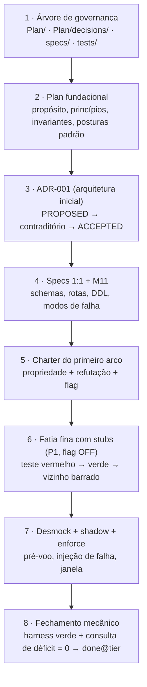
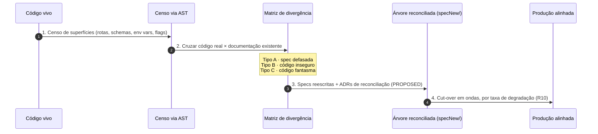

# 🛠️ 08 · Guia Prático de Aplicação

*Como adotar a EEE em projetos novos e legados, em passos objetivos*

> [!NOTE]
> Este capítulo é deliberadamente operacional. A fundamentação está em [02](02-principios.md), [05](05-regras-do-refinamento.md) e [09](09-fundamentacao-academica.md); aqui há só o que fazer, em que ordem, e como saber que terminou.

---

## 1. Projeto novo (greenfield)



### Passo 1 · Árvore de governança

```bash
mkdir -p Plan/decisions Plan/docs specs tests/unit tests/integration tests/adversarial
```

| Diretório | Camada | Conteúdo |
|---|---|---|
| `Plan/docs/` | 1 | Propósito, princípios, invariantes, limites |
| `Plan/decisions/` | 2 | ADRs numeradas ([template](../../templates/pt/adr-template.md)) |
| `specs/` | 3 | Contratos vivos + matriz M11 ([template](../../templates/pt/failure-modes-m11-template.md)) + ledger de flags ([template](../../templates/pt/flag-ledger-template.md)) |
| `tests/` | 4 | Suítes com par discordável; `adversarial/` é escrito sem ler a implementação |

### Passo 2 · Plan fundacional
Uma página. Contém: por que o sistema existe; o que ele **não pode** fazer; posturas de falha padrão (decisão → fail-closed; evidência → fail-open durável); orçamentos globais.

### Passo 3 · ADR-001
Nasce `PROPOSED`. Tem ≥ 2 alternativas, consequências e decisões numeradas (D1...Dn). A ratificação é um commit separado que cita evidência da Fase 1.

### Passo 4 · Specs e M11
Para cada interface: schema de entrada e saída, códigos de resposta, pré e pós-condições, e **uma linha de M11 por modo de falha**. Spec sem M11 não está completa.

### Passo 5 · Charter do primeiro arco
Use o [template de charter](../../templates/pt/arc-charter-template.md). Propriedade, condição de refutação, flag com domínio e default, gate de saída em oportunidades reais, janela de observação.

### Passo 6 · Fatia fina (P1)
- Flag `off` no código, explícita no deploy.
- Stubs marcados e com proveniência `unknown`.
- Bateria mínima: (1) alvo passa, (2) legado passa, (3) vizinho barra. Dívidas em `xfail(strict=True)`.
- **Antes de aceitar o verde:** injetar o defeito e ver o vermelho.

### Passo 7 · Desmock, shadow e enforce
- Desmockar um colaborador por vez, mantendo o contrato de forma.
- `shadow`: intent-log + detecção de divergência + endpoint de critério de saída.
- `enforce` só com pré-voo completo ([04 · Fase 7](04-fases-do-ciclo.md)); flip e ledger no mesmo commit.
- Injeção de falha para cada linha da M11 (indisponível, timeout, 5xx, corpo inválido, config vazia).

### Passo 8 · Fechamento mecânico

```bash
python3 examples/verification-harness/verify_hierarchy.py --project-root .
python3 examples/verification-harness/check_falsification.py --test-dir ./tests
```

Fecha quando: harness verde; a consulta que detectou o déficit retorna zero; o tier é declarado (`done@funcional`, nível de prova R15). Qualquer coisa acima disso é `done@gate` e pertence ao humano.

> [!IMPORTANT]
> **Leia a linha `examined`, não só o veredito.** O verificador falha quando não encontra código para examinar; na Fase 2, antes do código, use `--allow-missing-code`. Um verificador que não examina nada não pode dizer que passou. Projetos em TypeScript/Next.js usam o [adaptador TypeScript](../../examples/verification-harness/typescript/README.md); outras linguagens precisam de um adaptador que mantenha o mesmo contrato.

## 2. Projeto legado (brownfield)

Adotar a EEE em código existente é engenharia reversa em **quatro etapas**, com uma regra: **não edite a spec viva enquanto o censo estiver em andamento**.



### Etapa 1 · Censo estático
Extrair via AST (nunca grep) todas as rotas expostas, tabelas e colunas ativas, variáveis de ambiente lidas e flags declaradas. Registrar, para cada item, o **nível de ground truth** (R15).

### Etapa 2 · Matriz de divergência
Cruzar cada módulo contra os eixos comportamentais (identidade, autorização, orquestração, auditoria) e classificar:

| Tipo | Significado | Ação |
|---|---|---|
| **A · Spec defasada** | O código evoluiu legitimamente; o documento ficou atrás. | Atualizar a spec, com ADR de reconciliação se a decisão mudou. |
| **B · Código inseguro ou defeituoso** | Atalhos, fail-opens indevidos, identidade lida do payload. | Planejar conserto como arco, ordenado por R10. |
| **C · Código fantasma** | Rotas, stubs e flags sem consumidor. | Remoção limpa após prova de zero consumidores. |

### Etapa 3 · Árvore isolada
Construir as specs reconciliadas em `specNew/` até paridade 1:1 com o código **medido**. Cada divergência Tipo B vira charter de arco com flag.

### Etapa 4 · Cut-over em ondas
Promover `specNew/` a oficial; executar os arcos em ondas, cada um de `off` a `enforce` com seu pré-voo. **O primeiro arco deve ser o que degrada mais rápido enquanto espera**, não o mais "grave" no papel.

## 3. Checklist de condução de um arco

Imprimível. Um arco está completo quando todas as linhas têm evidência (comando + resultado, não inferência).

```markdown
### Abertura
- [ ] Charter com propriedade, condição de refutação, flag (domínio + default), postura M11, gate de saída, janela
- [ ] Reality-check do terreno: âncoras verificadas por símbolo (R14), nível de prova declarado (R15)
- [ ] Mecanismo de cada fase existe no código antes de ser briefado (R26)
- [ ] Divisão por nível de contexto perguntada ao operador e registrada (`delegation: none | tiered`, [§6](#6-divisão-de-tarefas-por-nível-de-contexto-opcional))
- [ ] Dados reais privados? Censo só de **forma** (contagens, formatos, cardinalidades), base sintética com proveniência `synthetic`, e varredura das sentinelas do dado real sobre o repositório = 0 antes do primeiro commit (gate de anonimização)

### P1 · Fatia fina (flag OFF)
- [ ] Stubs marcados na fonte; dados de andaime com proveniência `unknown`, `scaffold` ou `synthetic` (nunca `real`)
- [ ] Teste alvo vermelho → verde; legado verde; vizinho barrado (R2)
- [ ] Dívidas registradas em xfail(strict=True) (R29b)
- [ ] Flag no ledger; spec descreve o que foi criado (R30)

### P2 · Shadow
- [ ] Intent-log com par discordável (computado × vigente)
- [ ] Detecção de divergência e critério de saída consultável
- [ ] Janela medida em oportunidades reais (R5, R6)

### P3 · Hardening
- [ ] Um colaborador desmockado por vez, contrato de forma preservado
- [ ] Linha de M11 por modo de falha, cada uma com teste de injeção
- [ ] Raio histórico do stub medido; gatilho de aposentadoria verificável

### P4 · Cut-over
- [ ] Pré-voo: raio de explosão · reversível? · rollback ensaiado · precondição de estado · composição de flips
- [ ] Artefato de deploy exercitado ponta a ponta antes do flip (nível 3b)
- [ ] Flip e ledger no mesmo commit; valor explícito no deploy
- [ ] Reprodução ao vivo da propriedade e da refutação (nível 4), registrada no [template de evidência de cut-over](../../templates/pt/cutover-evidence-template.md)

### Fechamento
- [ ] Consulta de déficit = 0; harness verde
- [ ] done@tier declarado, com nível de prova
- [ ] Janela pós-enforce cumprida → flag aposentada; sweep da Fase 8 sem fantasmas
```

## 4. O ritual da Fase 8 (saída de sprint)

1. Rodar o harness e o sweep: `verify_hierarchy.py`, `check_falsification.py`, `sweep_codebase.py`.
2. Paridade bidirecional rotas ↔ specs; flags ↔ ledger; tabelas ↔ spec de banco.
3. Custódia: ADRs citadas existem no ramo principal; âncoras resolvem para símbolo.
4. Envelhecimento de `PROPOSED` além do prazo declarado: promover, emendar ou cancelar.
5. Proporção de gates não exercitados (R6) e **proof test** dos mecanismos de contingência em cadência.
6. Reexecutar a bateria de fechamento por reavaliação.
7. **Troca de executor** (pessoa, agente ou modelo): antes de aceitar qualquer relato anterior, o novo executor reexecuta a bateria inteira a partir do repositório. Divergência entre relato e reexecução vai para o ledger, mesmo quando pequena: é a resposta plausível em miniatura.

## 5. Adotando com agentes de IA

A EEE é agnóstica de ferramenta; o harness, não. Ele lê Python pela AST e TypeScript/Next.js por um [adaptador](../../examples/verification-harness/typescript/README.md); para outra linguagem, escreva um adaptador com o mesmo contrato antes de confiar no veredito. Dois pontos de encaixe:

- **Skills:** [`eee-governance-sweep`](../../skills/eee-governance-sweep/SKILL.md) automatiza a Fase 8; [`eee-adversarial-verifier`](../../skills/eee-adversarial-verifier/SKILL.md) instancia o papel *quem verifica* (testes a partir da spec, sem ler o código).
- **Divisão de papéis entre agentes:** a instanciação completa em dois agentes (reflexivo e executivo), com brief, reality-check de pré-voo e avaliação decisão por decisão, está no repositório irmão `EEEMIAD-dual`.

## 6. Divisão de tarefas por nível de contexto (opcional)

> [!NOTE]
> **Opcional e desligada por padrão.** Só entra em uso quando o operador responde **sim** à pergunta da fase de perguntas (abaixo). Sem essa resposta, o arco segue como nas seções 1 a 4. A instanciação com agentes e modelos de linguagem está no repositório irmão `EEEMIAD-dual`; aqui fica só o princípio, neutro quanto a ferramenta.

A ideia: o trabalho caro da EEE é **fechar** a tarefa (charter, spec, M11). Uma tarefa fechada pode ser executada por um executor de menor alcance e conferida por outro, de alcance intermediário, **contra um gate mecânico**. O nível de sistema fica com o que exige decisão.

### A pergunta (fase de perguntas, antes do primeiro charter)

Quem decide pergunta ao operador, uma vez por projeto ou por arco, e registra a resposta no charter (`delegation`):

> *"Adotar divisão de tarefas por nível de contexto neste arco? Tarefas locais com gate mecânico passam a ser executadas por um executor de menor alcance e conferidas por outro, com escalonamento depois de duas falhas. Custo extra: escrever um pacote por tarefa."*

| Resposta | Efeito |
|---|---|
| **sim** | `delegation: tiered` no charter; tarefas despachadas por [pacote de tarefa](../../templates/pt/task-packet-template.md) |
| **não** (ou sem resposta) | `delegation: none`; nada desta seção se aplica |

### Os três níveis e a regra de classificação

| Nível | Precisa ler | Exemplos | Executa | Confere |
|---|---|---|---|---|
| **Local** | uma seção de spec e até dois arquivos | gerar DDL da spec, um teste de uma linha da M11, preencher evidência a partir da saída de comandos, tradução, formatação | executor de menor alcance | intermediário, **contra o gate** |
| **Módulo** | um charter, sua spec e o código do módulo | P1 a P3 de um arco, oráculo independente, testes ponta a ponta, manifestos de deploy | intermediário | sistema, nos pontos de gate (probe-and-revert, par 3) |
| **Sistema** | Plan, ADRs, várias specs e o histórico | censo, ADRs, propriedade e refutação de charters, conflitos entre camadas, pré-voo, relatórios | sistema | **o humano** (`done@gate`) |

A regra, em ordem: exige **decisão** → sistema. Lê **mais de um módulo** → módulo. **Não tem gate mecânico** → não pode ser local. O resto é local.

### Quatro regras de operação

1. **Conferência cega.** Quem confere recebe o pacote, a saída e o gate; nunca o raciocínio de quem executou. Roda o gate antes de ler a saída.
2. **Escalonamento por falha.** Duas falhas no gate sobem a tarefa um nível. Falha repetida num nível é sinal de que o pacote não estava fechado: o defeito volta ao nível de sistema como defeito de spec.
3. **Oráculo de outro autor.** O oráculo de um arco é escrito por um executor diferente do que implementa (outro modelo, outra linguagem, outra pessoa). Barato, e reduz o erro correlacionado.
4. **Medir, não supor.** O registro de cada pacote (gate na primeira tentativa, escalonamentos, custo) é o que diz se a divisão economiza. Se a taxa de escalonamento do nível local passar do limite declarado no charter, a regra de classificação está errada.

## 7. Execução entre sessões (opcional)

> [!NOTE]
> Vale quando parte do trabalho só pode acontecer **noutro lugar**: outra máquina, outra rede, uma credencial que só outra sessão tem. É independente da §6 (que divide por tamanho de contexto); as duas podem coexistir. O protocolo concreto para sessões de agentes está no repositório irmão `EEEMIAD-dual`.

A divisão por lugar segue as mesmas regras do arco: quem decide fecha a tarefa, quem está no terreno executa, e a evidência volta como comando e saída. O que muda é que **a mensagem entre sessões passa a ser o pacote de tarefa**, e o canal tem propriedades que a sessão única não tem.

### Seis regras

| # | Regra | Por quê |
|---|---|---|
| 1 | **Execute onde estão o terreno e a credencial.** O pré-voo (Fase 7) e o reality-check rodam na sessão que enxerga o ambiente real. | Uma premissa sobre o ambiente só é refutada por quem o vê. |
| 2 | **O segredo não viaja.** Tokens e senhas ficam na sessão que os usa; a mensagem leva comandos e devolve saídas. Se um valor secreto precisa ser gravado no destino, o operador o grava lá. | Mensagem é registro durável fora do controle de quem a enviou. |
| 3 | **A mensagem é um pacote fechado.** Primeira linha autoexplicativa; natureza da ação declarada (`somente leitura` ou `escrita`); o que **não** fazer; os passos; o formato da resposta (comando + saída por passo). | Mensagem não se desfaz: corrigir depois do envio gera uma segunda instrução concorrente. |
| 4 | **Duas chaves para agir.** Toda escrita no ambiente remoto exige a autorização do operador **na sessão que age**, além da decisão na sessão que pede. Pedido de outra sessão não é autorização. | Mantém separados quem decide e quem executa; nenhuma sessão eleva a permissão de outra. |
| 5 | **Enviado não é lido.** Sem resposta, não houve execução. Silêncio não é aceite, e o estado do ambiente só é conhecido pela evidência que volta. | O canal pode não confirmar entrega nem leitura. |
| 6 | **A afirmação do par é informação.** O que a outra sessão conclui é verificado contra a spec e, quando possível, reexecutado da sessão que decide (nível R15 declarado). | O par também produz respostas plausíveis. |

### Estado que não sobrevive

A sessão remota pode reiniciar e perder variáveis de ambiente, inclusive a credencial. Trate isso como o *config-as-state* ([07 §6.7](07-anti-padroes.md)): o que a sessão precisa para agir deve ter uma fonte declarada (arquivo de ambiente com permissão restrita, cofre, variável do orquestrador). Uma falha `403` depois de um reinício é sinal de estado fora da fonte, não de permissão negada.

### Checklist de uma rodada entre sessões

```markdown
- [ ] A tarefa precisa mesmo do outro lugar (credencial, rede, máquina)? Se não, execute aqui.
- [ ] Mensagem com primeira linha autoexplicativa e ação declarada (somente leitura | escrita)
- [ ] Nenhum segredo no texto da mensagem
- [ ] Para escrita: decisão aqui + autorização do operador na sessão que age
- [ ] Resposta com comando + saída por passo; o que for reexecutável daqui foi reexecutado
- [ ] Evidência e tempos registrados no charter do arco (nível R15 de cada linha)
```
