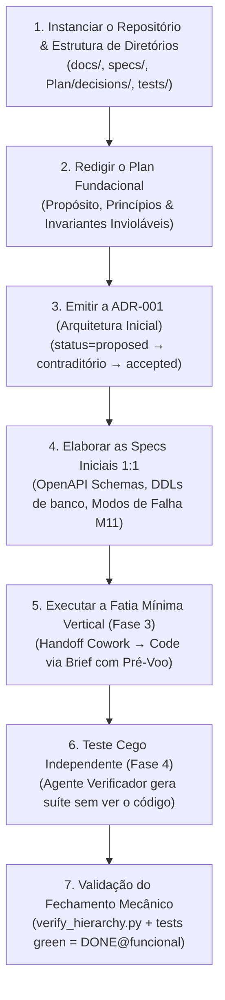
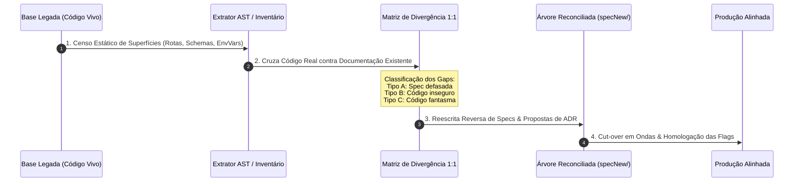

# 08. Guia Prático de Aplicação Passo a Passo
## Como Adotar a Metodologia em Projetos Greenfield e Brownfield

---

### 1. Roteiro para Projetos Novos (Greenfield)



#### Passo 1: Configurar a Árvore de Governança
Crie a estrutura de diretórios padronizada no repositório:
```bash
mkdir -p Plan/decisions specs tests/unit tests/integration tests/adversarial
```

#### Passo 2: O Primeiro Handoff Dual-Agent
1. O **Agente Reflexivo (Cowork)** produz a especificação formal e a ADR inicial.
2. O **Operador Humano** revisa e aprova a ADR (`status=accepted`).
3. O Cowork redige o **Brief do Agente Executivo** usando o template `templates/pt/brief-template.md`.
4. O **Agente Executivo (Code)** realiza o Reality-Check pré-voo, implementa o código e submete o Pull Request contendo a tag `closes ADR-001`.

---

### 2. Roteiro para Projetos Legados (Brownfield)

Adotar a EEEMIAD em uma base de código existente de grande escala exige uma estratégia de engenharia reversa e reconciliação progressiva em **4 Etapas**:



#### Etapa 1: Inventário Estático e Censo de Superfícies
- Extrair via AST todas as rotas de API realmente expostas pelos controladores (`@router.get`, `@router.post`).
- Extrair todas as tabelas, colunas e chaves estrangeiras ativas no banco de dados.
- Mapear todas as variáveis de ambiente lidas por `os.getenv` ou arquivos de configuração.

#### Etapa 2: A Matriz de Dupla Entrada de Divergências
Construir o livro-razão cruzando cada módulo estrutural contra os eixos comportamentais (Identidade, Autorização, Orquestração, Auditoria). 
Classificar cada discrepância em:
- **Tipo A (Especificação Defasada):** O código evoluiu legitimamente, mas a documentação ficou para trás $\to$ Atualizar a especificação para refletir a realidade.
- **Tipo B (Código Inseguro / Defeituoso):** O código implementou atalhos ou fail-opens indevidos $\to$ Planejar conserto no código.
- **Tipo C (Código Morto / Fantasma):** Rotas e tabelas sem nenhum consumidor $\to$ Planejar remoção limpa.

#### Etapa 3: Isolamento em `specNew/`
Não edite a especificação viva do legado diretamente enquanto o censo estiver em andamento. Construa as especificações reconciliadas em um diretório isolado (`specNew/`) até atingir **paridade estrita 1:1 com o código medido**.

#### Etapa 4: Cut-over e Homologação
Promova `specNew/` para a raiz de especificações oficiais e aplique as ADRs reconciliadas, convertendo gradualmente as flags de modo `shadow` para `enforce`.

---

### 3. O Ritual da Fase 8: Sprint-Exit Sweep
A cada término de ciclo ou sprint:
1. Rodar o script de verificação: `python3 examples/verification-harness/verify_hierarchy.py`.
2. Verificar se há alguma decisão em `status=proposed` há mais de 15 dias sem debate.
3. Checar a proporção de testes não-exercitados (Regra R6).
4. Validar se novas rotas criadas possuem cobertura na matriz M11 de modos de falha.
