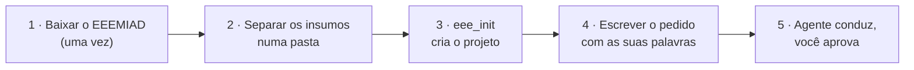

# 🚀 12 · Primeiros passos: um projeto novo com a EEE

*Para quem quer começar um projeto com a EEE sem ler os onze capítulos antes. Um comando cria o projeto inteiro; um agente de código conduz as etapas; você decide e aprova. (EN: [Getting started](../en/12-getting-started.md))*

---

## Visão geral



Você não copia arquivo nenhum à mão. O script `starter/eee_init.py` cria as pastas, copia os templates e os verificadores do EEEMIAD, escreve os documentos iniciais já com o nome do projeto, registra os insumos e faz o primeiro commit.

## 0. O que você precisa

| Ferramenta | Para quê | Como conferir |
|---|---|---|
| git | baixar o EEEMIAD e versionar o projeto | `git --version` |
| Python 3.8 ou mais novo | o script e os verificadores | `python3 --version` |
| bash | o comando de gate (`tools/gate.sh`) | Linux e macOS já têm; no Windows use Git Bash ou WSL |
| Um agente de código (recomendado) | conduzir as etapas com você | Claude Code, Codex, Cursor ou outro que leia `AGENTS.md` |

Se o `python3` da sua máquina for antigo, use o caminho de um mais novo no lugar dele (ex.: `python3.11`).

## 1. Baixe o EEEMIAD (uma vez só)

Fora da pasta do projeto, num lugar fixo:

```bash
git clone https://github.com/fuzaro/EEEMIAD.git ~/EEEMIAD
```

Já tem? Atualize: `git -C ~/EEEMIAD pull`.

## 2. Separe os insumos numa pasta

Coloque numa pasta tudo o que já existe sobre o sistema: layout de banco, telas, template de UX, prints do sistema antigo, planilhas de exemplo.

- **Sem dado real:** o script copia a pasta para dentro do projeto (`Plan/docs/insumos/`).
- **Com dado real ou privado** (nomes, e-mails, registros de produção): responda **sim** quando o script perguntar, ou use `--privado`. Os arquivos ficam onde estão; o projeto guarda só o inventário (nome, tamanho e hash de cada arquivo) e onde a pasta está.

## 3. Crie o projeto

```bash
python3 ~/EEEMIAD/starter/eee_init.py ~/projetos/meu-sistema --insumos ~/insumos-meu-sistema
```

O script pergunta o nome do projeto, uma frase sobre ele e se os insumos são privados. Para não ter perguntas, passe tudo na linha de comando:

```bash
python3 ~/EEEMIAD/starter/eee_init.py ~/projetos/meu-sistema \
  --nome "Meu Sistema" --descricao "Controla X para a equipe Y." \
  --insumos ~/insumos-meu-sistema --privado --stack ts --sim
```

| Opção | Efeito |
|---|---|
| `--nome` | nome do projeto (padrão: o nome da pasta) |
| `--descricao` | uma frase: o que o sistema faz e para quem |
| `--insumos PASTA` | pasta dos insumos |
| `--privado` | insumos com dado real: inventariar, nunca copiar |
| `--stack py` ou `ts` | verificadores para Python ou para Next.js/TypeScript (padrão: `py`); dá para mudar depois em `tools/gate.env` |
| `--idioma en` | documentos em inglês (padrão: `pt`) |
| `--sem-git` | não cria o repositório git |
| `--sim` | não pergunta nada |

O script nunca sobrescreve um arquivo existente e recusa uma pasta que já tenha `AGENTS.md`.

### O que foi criado

```text
meu-sistema/
├── AGENTS.md                  ← comece por aqui: regras, ordem de leitura, comandos (pessoas e agentes)
├── CLAUDE.md                  ← adaptador do Claude Code: só aponta para o AGENTS.md
├── Plan/
│   ├── docs/
│   │   ├── pedido.md          ← o que foi pedido, nas suas palavras + fase de perguntas
│   │   ├── matriz-pedido-arco.md  ← cada item do pedido → o arco que o entrega
│   │   ├── principios.md      ← o Plan: uma página (por que existe, o que não pode fazer)
│   │   └── insumos/           ← seus insumos (ou só o inventário, se privados)
│   └── decisions/             ← ADRs (decisões de arquitetura)
├── specs/charters/            ← specs e charters dos arcos
├── tests/{unit,integration,adversarial}/
├── eee/
│   ├── state/STATE.md         ← estado e pendências (a lista do que fazer agora)
│   ├── state/decisions-operator.md ← suas decisões fixas
│   ├── log.md                 ← diário de evidências (a entrada 1 já está lá)
│   └── kit/                   ← templates do EEEMIAD, com origem e versão (VERSION)
└── tools/gate.sh              ← o único comando de verificação (configuração em tools/gate.env)
```

> [!NOTE]
> **O gate começa vermelho, e isso é esperado.** Ao final, o script roda `tools/gate.sh` uma vez: a hierarquia passa e o passo R2 reprova com *No tests found*. A EEE não deixa dizer "pronto" sem evidência; o vermelho some quando o primeiro teste existir (etapa 5, arco P1). O resultado fica registrado na entrada 1 de `eee/log.md`.

## 4. Escreva o pedido

Abra `Plan/docs/pedido.md` e cole na seção 1 o que você quer, **com as suas palavras**: a mensagem, o e-mail ou o texto que descreve o sistema. Não resuma e não tente escrever "bonito". Esse é o único arquivo que só você pode escrever; todo o resto parte dele.

A seção 2 traz as perguntas que precisam de resposta antes da primeira decisão de arquitetura. Você pode respondê-las sozinho ou deixar o agente perguntar (próxima etapa).

## 5. Conduza com um agente

Abra o agente de código **na pasta do projeto**. Ele lê o `AGENTS.md` e o `eee/state/STATE.md` e sabe em que ponto o projeto está. Em cada etapa, cole o texto da coluna do meio e faça o que diz a coluna da direita.

| Etapa | O que colar para o agente | O que você faz |
|---|---|---|
| **A · Fundação** | *Leia o AGENTS.md e o eee/state/STATE.md. Estamos na fase de fundação da EEE. Faça comigo a fase de perguntas do Plan/docs/pedido.md, uma pergunta por vez, e anote as respostas. Depois leia os insumos, escreva o Plan/docs/principios.md e a matriz pedido × arco, e pare para eu aprovar. Não escreva código.* | Responde às perguntas. Lê o Plan (uma página) e aprova ou pede ajuste. |
| **B · Decisões** | *Escreva as ADRs a partir do Plan aprovado e dos insumos (arquitetura, modelo de dados a partir do layout de banco, interface a partir do template de UX), todas PROPOSED, com pelo menos duas alternativas cada. Pare para eu ratificar.* | Lê cada ADR e diz "aceito" ou o que mudar. A ratificação é um commit separado. |
| **C · Contratos** | *Escreva as specs governadas pelas ADRs aceitas (DDL do banco, telas, rotas), cada uma com a matriz M11 de modos de falha, e o ledger de flags. Rode tools/gate.sh e mostre o resultado.* | Confere se as telas e o banco correspondem ao que você espera. |
| **D · Primeiro arco** | *Abra o charter do primeiro arco com o template de eee/kit/templates/arc-charter-template.md, começando pelo item da matriz que mais degrada esperando. Mostre a propriedade e a condição de refutação antes de codar.* | Aprova o charter. |
| **E · Construção** | *Execute o arco de P1 a P4 conforme o EEEMIAD ch. 08 §3: teste vermelho antes do verde, par discordável, probe-and-revert, flag off → shadow → enforce, linha no eee/log.md a cada mudança. Pare antes de qualquer escrita em ambiente compartilhado.* | Autoriza flips e deploys. Fecha o arco (`done@gate`). |

Depois do primeiro arco, repita **D** e **E** para o próximo item da matriz.

> [!TIP]
> **O que é seu e o que é do agente.** O agente escreve e verifica; você **decide**: aprova o Plan, ratifica ADRs, abre arcos, autoriza escrita em ambiente compartilhado e fecha `done@gate`. Se o agente disser "pronto" sem mostrar o comando e o resultado, peça os dois.

## 6. A rotina

| Quando | O quê |
|---|---|
| Antes de começar o dia | Ler `eee/state/STATE.md` (pendências) |
| Depois de qualquer mudança | `tools/gate.sh` (um comando, um código de saída) |
| A cada decisão sua | Uma linha em `eee/state/decisions-operator.md`, com data |
| A cada mudança de estado (arco, flip, deploy, incidente) | Uma linha em `eee/log.md`, no mesmo commit |
| Um pedido novo | Uma linha em `pedido.md` §3 e um item novo na matriz |

## 7. Problemas comuns

| Sintoma | Causa e solução |
|---|---|
| `Python >= 3.8 required` (saída 3) | Python antigo. Rode com um mais novo: `python3.11 ~/EEEMIAD/starter/eee_init.py ...` |
| `recusado: ... já tem AGENTS.md` (saída 2) | A pasta já é um projeto EEE. Escolha outra pasta. |
| `o commit falhou` | O git não sabe quem você é: `git config --global user.name "Seu Nome"` e `git config --global user.email ...`, depois `git commit -m "início"` na pasta do projeto. |
| Gate com `FAILED: 1 step(s)` logo no início | Esperado: ainda não há teste (seção 3, nota). |
| `tools/gate.sh` não roda no Windows | Use Git Bash ou WSL. |
| Quero o kit de uma versão nova do EEEMIAD | Rodar o script de novo não sobrescreve nada. Atualize com `git pull` no EEEMIAD, copie os arquivos que mudaram para `eee/kit/` e `tools/eee/`, atualize `eee/kit/VERSION` e registre no diário. |

## 8. Quando ler o resto

Você não precisa ler tudo antes de começar. Leia quando a etapa pedir:

- Etapas A–C: [08 §1 · Projeto novo](08-guia-de-aplicacao.md#1-projeto-novo-greenfield) e [03 · Hierarquia da Verdade](03-hierarquia-da-verdade.md).
- Etapas D–E: [08 §3 · Checklist de condução de um arco](08-guia-de-aplicacao.md#3-checklist-de-condução-de-um-arco) e [06 · Construção Evolutiva](06-construcao-evolutiva.md).
- Se os insumos descrevem um sistema que já existe: [08 §2 · Projeto legado](08-guia-de-aplicacao.md#2-projeto-legado-brownfield).
- Para trabalhar com dois agentes ou dividir tarefas por nível de contexto: o repositório irmão EEEMIAD-dual.
- Termos novos: [11 · Glossário](11-glossario.md).
